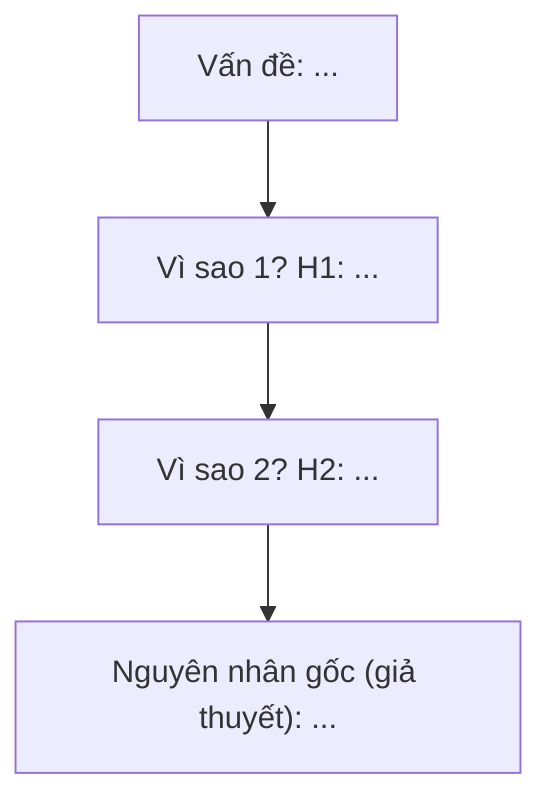

# Phân tích nguyên nhân gốc (Root Cause Analysis)

## 1. Mục đích
Root Cause Analysis là cách lần ngược từ một vấn đề đã xảy ra để tìm điều kiện sâu nhất khiến nó xảy ra, sao cho sửa điều kiện đó thì vấn đề không tái diễn. Ở Solution Evaluation, skill dùng log sự cố và mô tả vấn đề để dựng chuỗi 5 Whys hoặc sơ đồ xương cá. Mọi nguyên nhân tìm được chỉ là **giả thuyết** cho tới khi có kiểm chứng; skill trả về danh sách việc cần kiểm chứng, không phải kết luận.

## 2. Đầu vào cần có
- Mô tả vấn đề: hiện tượng, phạm vi, thời gian, mức lệch so với mục tiêu (ví dụ 4 giờ của R1).
- Log hoặc bằng chứng sự cố đã ẩn danh (đoạn log, ticket, ảnh chụp trạng thái đã che).
- Bối cảnh nghiệp vụ liên quan: rule, use case, quy trình mà vấn đề đụng tới.
- Tùy chọn: dữ liệu thống kê từ mine-usage-data, kết quả phỏng vấn người liên quan, các lần xảy ra trước.

Thiếu đầu vào bắt buộc nào thì **hỏi lại người dùng trước khi làm**. Không tự bịa log, số liệu hay bằng chứng để lấp chỗ trống.

## 3. Các bước
1. Phát biểu vấn đề đo được: cái gì, ở đâu, từ khi nào, lệch bao nhiêu so với mục tiêu. Không đưa nguyên nhân hay giải pháp vào câu phát biểu.
2. Dựng dòng thời gian từ log. Tách sự kiện **quan sát được** (có dòng log) khỏi **suy luận**. Đoạn trích không có dòng nào đó chưa chứng minh sự kiện không xảy ra.
3. Chọn phương pháp: chuỗi nối tiếp rõ thì 5 Whys; nhiều nhóm độc lập thì xương cá; còn mơ hồ thì dùng xương cá để phủ rồi 5 Whys đào nhánh nổi bật. Xem `references/phuong-phap-va-mermaid.md`.
4. Hỏi "vì sao" lặp lại. Mỗi câu trả lời là một giả thuyết mã `H1`, `H2`, kèm bằng chứng trích từ input hoặc ghi "chưa có". Rẽ nhánh khi có nhiều cách giải thích.
5. Chỉ dừng khi giả thuyết cuối là cơ chế mà tổ chức sửa được (quy trình, rule, cấu hình) chứ không dừng ở hành vi của một người hay ở triệu chứng.
6. Đối chiếu 6 nhóm xương cá (Quy trình, Con người, Hệ thống, Dữ liệu, Quy tắc nghiệp vụ, Bên ngoài) để tìm nhóm bị bỏ sót; ghi khoảng trống.
7. Lập danh sách cần kiểm chứng: cách kiểm, ai làm, "nếu sai thì sẽ thấy gì", ưu tiên (rẻ và tác động lớn trước), trạng thái mặc định "Chưa kiểm chứng".
8. Nêu điều chưa thể kết luận và câu hỏi mở. Không đề xuất giải pháp trừ khi người dùng yêu cầu.

## 4. Mẫu đầu ra
````
## Phân tích nguyên nhân gốc: <vấn đề>
### A. Phát biểu vấn đề
- Hiện tượng / Phạm vi và thời gian / Mục tiêu so sánh / Mức lệch
### B. Dòng thời gian từ log
| Thời điểm | Sự kiện | Nguồn (dòng log hoặc tài liệu) |
### C. Phương pháp đã chọn và lý do
### D. Sơ đồ
#### D1. 5 Whys

#### D2. Xương cá (bảng)
| Nhóm | Giả thuyết (mã H) | Ghi chú |
(đủ 6 nhóm; nhóm trống ghi "chưa có giả thuyết" và nêu khoảng trống)
### E. Nguyên nhân cần kiểm chứng
| ID | Giả thuyết | Bằng chứng hiện có | Cách kiểm chứng (người) | Nếu sai thì sẽ thấy | Ưu tiên | Trạng thái |
### F. Điều chưa thể kết luận
### Câu hỏi mở
1. <câu hỏi, ghi rõ cần ai trả lời>
````

## 5. Tự kiểm trước khi trả kết quả
- [ ] Câu phát biểu vấn đề có số đo và mục tiêu so sánh, không chứa nguyên nhân hay giải pháp?
- [ ] Mọi nguyên nhân đều mang mã H, trạng thái "Chưa kiểm chứng", và không câu nào được viết như sự thật đã xác lập?
- [ ] Mỗi giả thuyết có bằng chứng trích từ input (hoặc ghi "chưa có"), cách kiểm chứng và điều sẽ thấy nếu giả thuyết sai?
- [ ] Giả thuyết cuối của chuỗi 5 Whys là cơ chế sửa được, không phải lỗi của một cá nhân hay chỉ là triệu chứng?
- [ ] Mermaid hợp lệ (nhãn trong ngoặc kép) và bảng xương cá đủ 6 nhóm, có nêu khoảng trống?
- [ ] Có nêu rõ cỡ mẫu và phần chưa thể kết luận, và câu hỏi mở xuất phát từ chỗ thiếu của input?

## 6. BA phải verify
- AI hay nhầm tương quan với nhân quả: hai việc cùng xảy ra (đơn chậm, kế toán bận) chưa chứng minh việc này gây việc kia. Cần so sánh có đối chứng hoặc kiểm chứng trực tiếp.
- AI hay dừng 5 Whys sớm ở câu trả lời nghe hợp lý ("vì kế toán chưa xử lý") thay vì đi tới cơ chế (không có người phụ trách, không có thời hạn). Ngược lại, đừng kéo dài thành chuyện chung chung.
- AI có thể bịa dòng log, số liệu hoặc trích dẫn không có trong input. BA đối chiếu từng trích dẫn với log gốc.
- Chuỗi kết thúc ở "do sơ suất của người X" là dấu hiệu chưa đủ sâu; hỏi tiếp vì sao hệ thống cho phép.
- Đừng ép về một gốc duy nhất: sự cố thường có nhiều nguyên nhân cùng góp.

## 7. An toàn dữ liệu
- Không đưa dữ liệu khách hàng thật vào. Dùng log và mã đã ẩn danh (mã đơn, mã đại lý băm).
- Không dán log chứa thông tin cá nhân (tên, số điện thoại, email, địa chỉ IP, token), giá, hợp đồng hay công nợ thật. Che hoặc thay bằng trạng thái (ví dụ `OVERDUE`) rồi mới dán.
- Chỉ cắt đoạn log liên quan; nói về con người bằng vai trò thay vì tên.
- Gắn nhãn `[GIẢ ĐỊNH]` cho mọi rule, số liệu, tên riêng không có nguồn trong đầu vào.

## 8. Câu hỏi mở
Luôn kết thúc đầu ra bằng mục này:

```
### Câu hỏi mở
1. <câu hỏi còn thiếu, ghi rõ cần ai trả lời>
```
