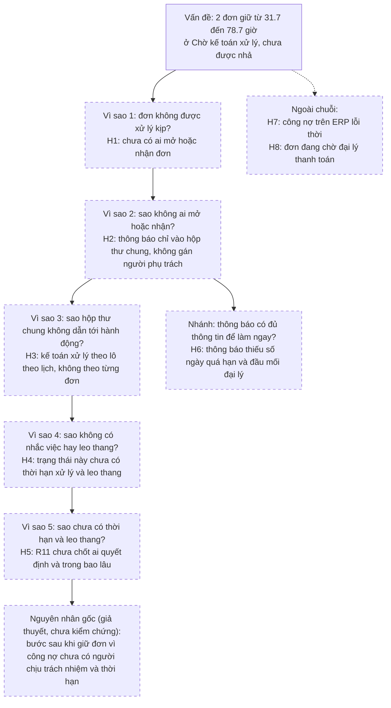

## Phân tích nguyên nhân gốc: đơn đại lý bị giữ lâu ở trạng thái "Chờ kế toán xử lý"

### A. Phát biểu vấn đề
- **Hiện tượng:** đơn bị giữ vì đại lý quá hạn công nợ (ERP trả `OVERDUE`) nằm ở "Chờ kế toán xử lý" và chưa được nhả.
- **Phạm vi và thời gian:** 2 đơn trong tuần 14/12 đến 18/12/2026 `[GIẢ ĐỊNH]`: DH-2026-000105 (đại lý DL-c40e, tạo trên cổng) và DH-2026-000113 (đại lý DL-a07f, sales admin nhập tay từ email/Zalo).
- **Mục tiêu so sánh:** xác nhận đơn trong 4 giờ (R1, `[GIẢ ĐỊNH]`).
- **Mức lệch:** tính đến 18/12/2026 17:00, DH-2026-000105 đã giữ 78.7 giờ và DH-2026-000113 giữ 31.7 giờ, cả hai chưa được nhả. Mẫu chỉ 2 đơn nên chưa nói được vấn đề phổ biến đến đâu.

### B. Dòng thời gian từ log
| Thời điểm | Sự kiện | Nguồn |
|---|---|---|
| 15/12 10:20:41 | Đại lý DL-c40e gửi DH-2026-000105 trên cổng | `portal.order.submit` |
| 15/12 10:20:42 | ERP kiểm công nợ, kết quả `OVERDUE`; đơn chuyển sang `CHO_KE_TOAN_XU_LY` | `erp.credit_check`, `portal.order.status` |
| 15/12 10:20:43 | Email `ORDER_HELD_ACCOUNTING` gửi tới `hop-thu-ke-toan`, kết quả `SENT` | `notify.email.send` |
| 15/12 đến 18/12 | Đoạn trích không có dòng nào khác về DH-2026-000105 (không có dòng mở đơn, gán người, nhắc việc). Chưa kết luận được là không có hành động vì trích chưa kèm log thao tác kế toán | Suy luận, không phải quan sát |
| 17/12 09:20:12 | Sales admin nhập tay DH-2026-000113 vào ERP | `erp.order.create_manual` |
| 17/12 09:20:13 đến 09:20:14 | `OVERDUE`; đơn chuyển `CHO_KE_TOAN_XU_LY`; email tới `hop-thu-ke-toan`, `SENT` | `erp.credit_check`, `erp.order.status`, `notify.email.send` |
| 18/12 17:00:00 | Báo cáo: 2 đơn đang chờ, cũ nhất DH-2026-000105 | `report.pending_orders` |

### C. Phương pháp đã chọn và lý do
Dùng 5 Whys có nhánh, vì log cho thấy một chuỗi rõ: kiểm công nợ, giữ đơn, gửi thông báo, rồi im lặng. Kèm bảng xương cá 6 nhóm để kiểm tra có bỏ sót nhóm nguyên nhân nào không. Cả hai đều chỉ tạo giả thuyết.

### D. Sơ đồ
#### D1. 5 Whys

#### D2. Xương cá (bảng)
| Nhóm | Giả thuyết | Ghi chú |
|---|---|---|
| Quy trình | H3 xử lý theo lô; H4 chưa có thời hạn và leo thang | H4 có gợi ý từ spec (UC-01 không nêu thời hạn) |
| Con người | H1 chưa có ai mở hoặc nhận đơn | Chỉ để tìm cơ chế, không quy lỗi cho cá nhân |
| Hệ thống | H2 thông báo vào hộp thư chung; H6 nội dung thông báo thiếu thông tin | H2 có quan sát trong log |
| Dữ liệu | H7 công nợ trên ERP lỗi thời | Chưa có bằng chứng |
| Quy tắc nghiệp vụ | H5 R11 chưa chốt owner và thời hạn | Có căn cứ từ case |
| Bên ngoài | H8 đơn chờ đại lý thanh toán hoặc giải trình | Chưa có bằng chứng |

Khoảng trống: chưa có giả thuyết về khối lượng việc của kế toán (số đơn bị giữ mỗi ngày). Cần số liệu từ skill mine-usage-data.

### E. Nguyên nhân cần kiểm chứng
| ID | Giả thuyết | Bằng chứng hiện có | Cách kiểm chứng (người) | Nếu sai thì sẽ thấy | Ưu tiên | Trạng thái |
|---|---|---|---|---|---|---|
| H1 | Đơn chưa được ai mở hoặc nhận trong hàng đợi kế toán | Chưa có: đoạn trích không kèm log thao tác phía kế toán nên chưa quan sát được ai mở hay nhận đơn | Lấy log truy cập/audit màn hình xử lý đơn của 2 đơn (Quản trị hệ thống) | Có người mở đơn nhiều lần nhưng không nhả được, nghiêng về H7 hoặc H8 | Cao | Chưa kiểm chứng |
| H2 | Thông báo chỉ gửi vào hộp thư chung `hop-thu-ke-toan`, không gán người | Quan sát: `to=hop-thu-ke-toan`, `SENT` cho cả hai đơn | Xem cấu hình template `ORDER_HELD_ACCOUNTING` và danh sách người nhận hộp thư (dev, Kế toán trưởng) | Có người được gán đích danh hoặc có thông báo trong cổng | Cao | Chưa kiểm chứng |
| H3 | Kế toán xử lý theo lô theo lịch cố định | Gợi ý: Kế toán trưởng họp 1 buổi/tuần (không chứng minh được gì) | Phỏng vấn kế toán; lấy thời điểm nhả của các đơn Chờ kế toán xử lý trong 4 tuần, xem có cụm theo ngày không (Kế toán trưởng, BA) | Thời điểm nhả rải đều trong ngày | Trung bình | Chưa kiểm chứng |
| H4 | Trạng thái này chưa có thời hạn xử lý, nhắc việc, leo thang | Tài liệu: UC-01 E2 chỉ nêu chuyển trạng thái và thông báo, không nêu thời hạn xử lý. Chưa có: bằng chứng về job nhắc (đoạn trích không đủ để kết luận có hay không) | Đọc lại spec và cấu hình job nhắc (BA, dev) | Có rule nhắc nhưng không chạy, tức lỗi cấu hình chứ không phải thiếu rule | Cao | Chưa kiểm chứng |
| H5 | R11 chưa chốt ai quyết định và trong bao lâu sau khi báo kế toán | Tài liệu: R11 nêu hai phương án, không có thời hạn | Tra BRD, biên bản; hỏi sponsor và Kế toán trưởng (BA) | Đã có quyết định ghi lại về owner và thời hạn | Trung bình | Chưa kiểm chứng |
| H6 | Nội dung thông báo thiếu thông tin để làm ngay | Chưa có: log chỉ ghi tên template | Xin mẫu email đã ẩn danh (dev) | Email đã đủ thông tin; chậm do lý do khác | Thấp | Chưa kiểm chứng |
| H7 | ERP trả `OVERDUE` do công nợ lỗi thời (đại lý đã thanh toán nhưng chưa ghi sổ hoặc chưa đồng bộ) | Chưa có | Đối chiếu trạng thái công nợ tại thời điểm kiểm với sổ kế toán cho 2 đại lý; không dán số tiền vào chat (Kế toán trưởng) | Công nợ quá hạn là thật | Trung bình | Chưa kiểm chứng |
| H8 | Đơn đang chờ đại lý thanh toán hoặc giải trình, không phải chờ kế toán | Chưa có: hệ thống chưa ghi "đang chờ ai" | Hỏi sales khu vực và kế toán đã liên hệ đại lý chưa, khi nào | Chưa ai liên hệ đại lý | Trung bình | Chưa kiểm chứng |

### F. Điều chưa thể kết luận
- Chưa biết đây là hiện tượng phổ biến hay chỉ 2 đơn: cần lấy toàn bộ đơn từng ở trạng thái này trong ít nhất 4 tuần (skill mine-usage-data).
- Log trích chưa kèm thao tác phía kế toán, nên chưa phân biệt được "không ai xem" với "đã xem nhưng chưa nhả".
- DH-2026-000105 đi qua cổng còn DH-2026-000113 do sales admin nhập tay; chưa chắc hai đơn có cùng nguyên nhân.
- Các giả thuyết không loại trừ nhau; có thể nhiều nguyên nhân cùng góp.
- Chưa đề xuất giải pháp; chỉ nên bàn sau khi các giả thuyết ưu tiên Cao được kiểm chứng.

### Câu hỏi mở
1. Có lấy được log thao tác/audit của người dùng kế toán cho DH-2026-000105 và DH-2026-000113 không? Cần Anh Kiên (Quản trị hệ thống).
2. Ai nhận hộp thư `hop-thu-ke-toan` và ai chịu trách nhiệm xử lý đơn bị giữ vì công nợ? Cần Chị Loan (Kế toán trưởng).
3. Hai đơn đã được nhả chưa, vào lúc nào và vì lý do gì? Cần sales admin hoặc Chị Loan.
4. Sau khi báo kế toán, đơn bị giữ nên được xử lý trong bao lâu, và mục tiêu 4 giờ của R1 có áp dụng cho nhóm đơn này không? Cần Anh Quang (Giám đốc Kinh doanh).
5. Có tồn tại thông báo hoặc nhắc việc nào ngoài email (trong cổng, Zalo) mà log trích không ghi? Cần dev của cổng.
