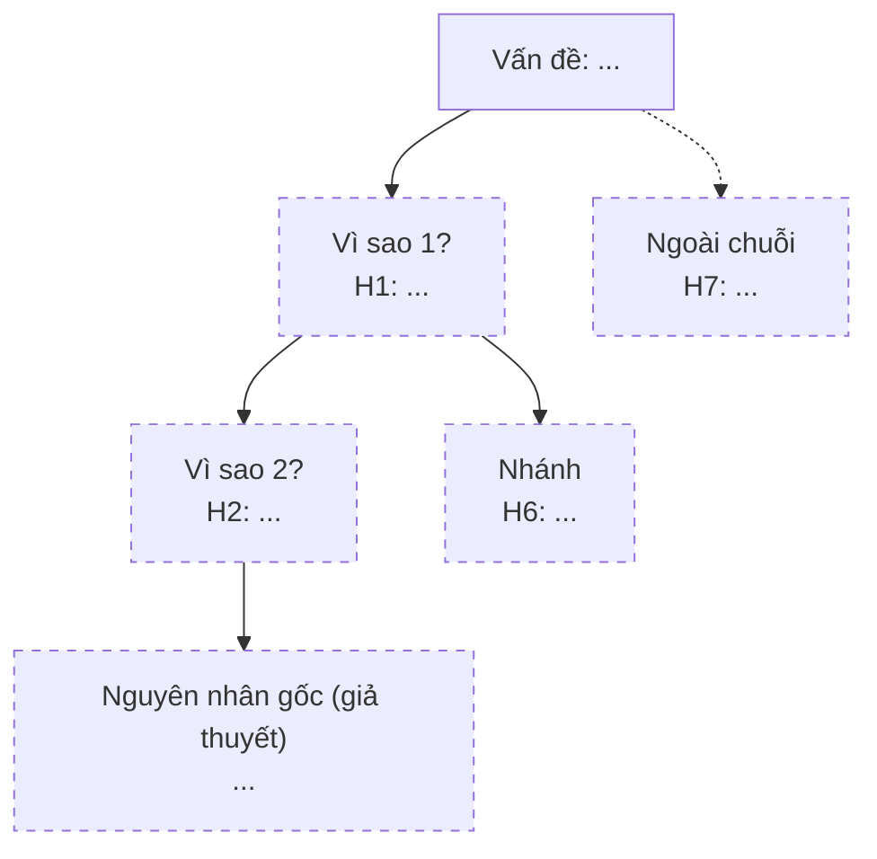
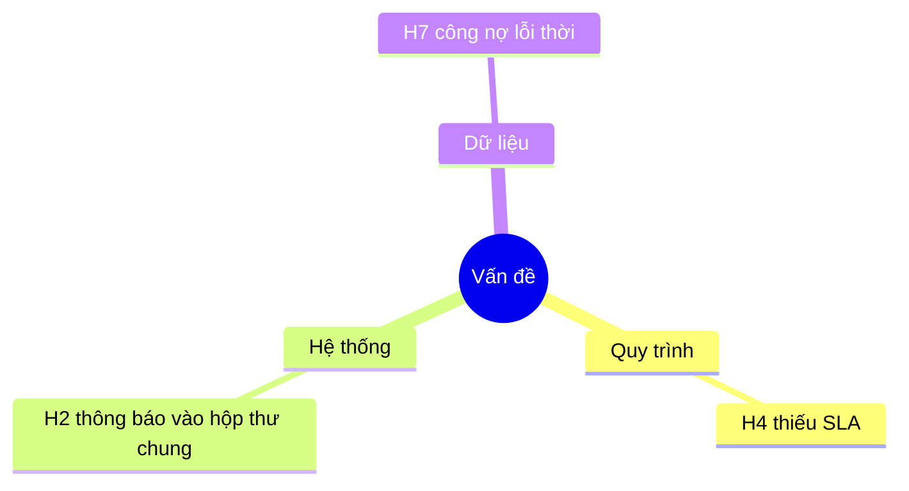

# Tham khảo: chọn phương pháp, Mermaid, giả thuyết kiểm chứng được

## 1. Chọn phương pháp

| Tình huống | Phương pháp | Lý do |
|---|---|---|
| Log cho thấy chuỗi sự kiện nối tiếp, một triệu chứng rõ | 5 Whys | Đi sâu theo một mạch nhân quả |
| Nhiều nhóm yếu tố có thể góp (người, quy trình, hệ thống, dữ liệu) | Xương cá | Phủ rộng trước, tránh bỏ sót nhóm |
| Mơ hồ, chưa rõ chuỗi | Xương cá rồi 5 Whys cho nhánh nổi bật | Phủ trước, đào sau |
| Sự cố có nhiều biểu hiện khác nhau | Tách thành từng vấn đề rồi phân tích riêng | Mỗi vấn đề một sơ đồ |

"5" chỉ là gợi ý. Dừng khi giả thuyết cuối là cơ chế sửa được; có thể 3 hoặc 7 bước.

## 2. Sáu nhóm xương cá và câu hỏi gợi ý
- **Quy trình:** có bước, người nhận việc, thời hạn, leo thang cho tình huống này chưa?
- **Con người:** ai cần biết, họ có biết không, có đủ thông tin và thời gian không? (Chỉ để tìm cơ chế, không quy lỗi cho cá nhân.)
- **Hệ thống:** hệ thống có làm đúng thiết kế không, thông báo gửi tới đâu, cấu hình thế nào?
- **Dữ liệu:** dữ liệu đầu vào có lỗi thời, thiếu, đồng bộ trễ không?
- **Quy tắc nghiệp vụ:** rule có đầy đủ, mâu thuẫn, hay chưa chốt không?
- **Bên ngoài:** bên thứ ba (đại lý, ERP, nhà cung cấp) có phụ thuộc không?

## 3. Mermaid mẫu

5 Whys có nhánh (nhãn luôn trong ngoặc kép; xuống dòng bằng ` `; tránh dấu `"` trong nhãn):

Xương cá dạng mindmap (khi muốn sơ đồ thay cho bảng):

## 4. Viết giả thuyết kiểm chứng được
- Dạng: "Nếu <giả thuyết> đúng thì sẽ thấy <quan sát cụ thể>; nếu sai thì sẽ thấy <quan sát khác>".
- Mỗi giả thuyết một cách kiểm chứng rẻ nhất (đọc cấu hình, hỏi một người, đối chiếu hai nguồn) trước các cách tốn kém (khảo sát, thử nghiệm).
- Ghi rõ loại bằng chứng: **quan sát** (dòng log), **tài liệu** (rule, use case), **gợi ý** (chi tiết gián tiếp trong bối cảnh), **chưa có**. Gợi ý không được coi là bằng chứng.
- Khi chỉ có 1–3 trường hợp, ghi rõ không thể nói là phổ biến; đề xuất lấy mẫu rộng bằng mine-usage-data.

## 5. Lỗi hay gặp
- Phát biểu vấn đề đã chứa nguyên nhân ("kế toán làm chậm").
- Dùng sự vắng mặt của dòng log trong đoạn trích như bằng chứng sự kiện không xảy ra.
- Một nhánh duy nhất, bỏ qua nguyên nhân bên ngoài (đại lý chưa thanh toán, ERP trả dữ liệu cũ).
- Chuyển ngay sang giải pháp khi giả thuyết chưa được kiểm chứng.
