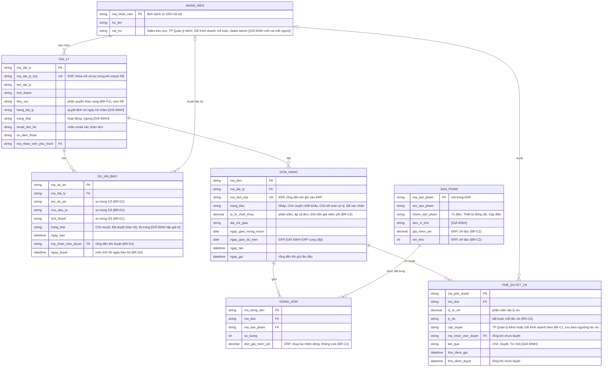

# Đầu vào mẫu: build-data-dictionary (case Đại Việt Electric)

## Yêu cầu của người dùng
Lập data dictionary cho các trường của Đơn hàng (DON_HANG) và Dòng đơn (DONG_DON) trong ERD bên dưới. Nhớ giá và tồn kho có nguồn là ERP, không ai sửa trên cổng.

## ERD (đầu ra của skill draft-data-model, dán nguyên)

## Dữ liệu mẫu (bịa, đã ẩn danh `[GIẢ ĐỊNH]`)
DON_HANG:

| ma_don | ma_dai_ly | ma_don_erp | trang_thai | ty_le_chiet_khau | dia_chi_giao | ngay_giao_mong_muon | ngay_tao | ngay_gui |
|---|---|---|---|---|---|---|---|---|
| DH-2026-000101 | DL-0007 | ERP-884201 | Đã xác nhận | 3,00 | Kho đại lý (ẩn danh), Đà Nẵng | 2026-11-20 | 2026-11-03T09:30:00+07:00 | 2026-11-03T09:41:00+07:00 |
| DH-2026-000102 | DL-0012 | (rỗng) | Chờ duyệt chiết khấu | 8,50 | Công trình A (ẩn danh), Hà Nội | 2026-11-25 | 2026-11-03T10:05:00+07:00 | 2026-11-03T10:20:00+07:00 |

DONG_DON:

| ma_dong_don | ma_don | ma_san_pham | so_luong | don_gia_niem_yet |
|---|---|---|---|---|
| DD-00000201 | DH-2026-000101 | SP-0001 | 4 | 1.250.000 |
| DD-00000202 | DH-2026-000102 | SP-0002 | 10 | 380.000 |

## Quy tắc và nguồn đã biết
- BR-C2 (R6): giá niêm yết và tồn kho lấy từ ERP; trên cổng không ai sửa.
- BR-C1: chiết khấu dưới 5%: đại lý tự áp. Từ 5% đến 10%: TP Quản lý kênh duyệt. Trên 10%: Giám đốc Kinh doanh duyệt `[GIẢ ĐỊNH]`. Quy ước đầu mút `[GIẢ ĐỊNH]`: đúng 5% và đúng 10% thuộc bậc 5%–10%; chiết khấu chuẩn của đại lý mặc định 0%.
- BR-C3: chiết khấu tính trên giá niêm yết, áp cho cả đơn.
- BR-C6: đơn chưa duyệt chiết khấu thì chưa ghi vào ERP.
- BR-C7 (R11): đại lý quá hạn công nợ thì đơn giữ lại, Kế toán được thông báo.
- UC-01: trạng thái đơn gồm Nháp, Chờ duyệt chiết khấu, Chờ kế toán xử lý, Đã xác nhận. Ghi vào ERP thì có mã đơn. Bước 7 gồm 7a kiểm tra công nợ trên ERP và 7b ghi đơn vào ERP. Không đủ tồn kho thì không thêm được dòng (E1). E2 (quá hạn công nợ, bước 7a) → Chờ kế toán xử lý. E3 (BA đề xuất `[GIẢ ĐỊNH]`, ERP không phản hồi ở bước 7, tại 7a hoặc 7b) và E4 (mất kết nối khi gửi, bước 6) → Nháp.
- Tài liệu kỹ thuật ERP chưa có: định dạng mã ERP, mã sản phẩm, độ dài chưa biết.
