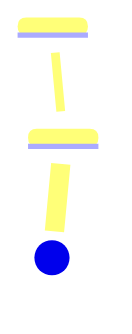

# Mind map (Mind Mapping)

## 1. Mục đích
Mind Mapping là cách trình bày suy nghĩ thành một cây ý: một chủ đề ở giữa, các nhánh chính tỏa ra, nhánh con chi tiết dần. Nó giúp thấy cả bức tranh trên một trang, phát hiện nhánh còn trống, và chia sẻ hiểu biết chung trong nhóm. Mind map không thể hiện thứ tự thời gian hay điều kiện rẽ nhánh, nên không thay được flow hay use case. Skill này dựng cây từ ghi chú hoặc spec có sẵn, không thêm nội dung mới ngoài nguồn.

## 2. Đầu vào cần có
- Ghi chú hoặc spec nguồn (dán văn bản).
- Chủ đề trung tâm hoặc mục đích đọc (tổng quan phạm vi, chuẩn bị phỏng vấn, ...) (tùy chọn; thiếu thì đề xuất từ nguồn).
- Mức chi tiết mong muốn: chỉ cấp 1–2 hay đủ 4 cấp (tùy chọn; mặc định tối đa 4 cấp).

Thiếu ghi chú hoặc spec thì **hỏi lại người dùng trước khi làm**. Không tự bịa để lấp chỗ trống.

## 3. Các bước
1. Chốt chủ đề trung tâm (một cụm danh từ ngắn) và mục đích đọc.
2. Đọc nguồn và tách thành ý đơn; mỗi ý giữ mã nguồn nếu có (R*, BR-*, UC-*, F*).
3. Chọn nhánh cấp 1 theo nhóm tự nhiên của nội dung, tối đa 8, tên là danh từ.
4. Xếp ý vào nhánh: mỗi nút tối đa khoảng 8 từ, sâu tối đa 4 cấp, mỗi ý chỉ xuất hiện một lần.
5. Dựng sơ đồ Mermaid kiểu `mindmap`, thụt lề bằng 2 dấu cách. Nhãn không dùng ngoặc tròn, ngoặc vuông, ngoặc nhọn, nháy, dấu hai chấm, chấm phẩy; viết "giả định" thay cho `[GIẢ ĐỊNH]`.
6. Lập bảng nhánh cấp 1: nội dung chính, mã nguồn.
7. Tìm nhánh trống, nút mồ côi, hai ý mâu thuẫn; ghi ra, không thêm nút để lấp.
8. Gợi ý bước dùng tiếp: nhánh nào sang build-glossary, use case, hỏi người.
9. Kết bằng "Câu hỏi mở".

## 4. Mẫu đầu ra
````
## Mind map: <chủ đề trung tâm>
**Nguồn:** ... · **Mục đích đọc:** ... · **Quy ước:** nhãn "giả định" = nội dung chưa có nguồn xác nhận

### Sơ đồ


### Bảng nhánh
| Nhánh | Nội dung chính | Nguồn (mã) |
|---|---|---|

### Nhánh còn trống hoặc thiếu nguồn
| Nhánh / nút | Thiếu gì | Hỏi ai |
|---|---|---|

### Gợi ý dùng tiếp
- <nhánh> → <skill hoặc bước tiếp theo>

### Câu hỏi mở
1. <câu hỏi> (cần: <ai trả lời>)
````
Khi người dùng cần bản chữ, xuất thêm outline dạng danh sách lồng nhau với cùng nội dung.

## 5. Tự kiểm trước khi trả kết quả
- [ ] Mỗi nút trong sơ đồ có nguồn trong đầu vào (hoặc được gắn "giả định")?
- [ ] Số nhánh cấp 1 không quá 8 và độ sâu không quá 4 cấp?
- [ ] Mỗi ý chỉ xuất hiện một lần, không nút nào lặp ở hai nhánh?
- [ ] Nhãn không chứa ký tự làm hỏng cú pháp Mermaid và thụt lề nhất quán?
- [ ] Nhánh trống và mâu thuẫn được liệt kê, không bị che bằng nút bịa?
- [ ] Bảng nhánh khớp nhánh trong sơ đồ (cùng tên, cùng số nhánh)?

## 6. BA phải verify
- AI hay thêm nút "cho đầy đủ" không có trong nguồn; BA đối chiếu từng nhánh với ghi chú gốc.
- Cú pháp Mermaid có thể hỏng khi nhãn có ký tự đặc biệt; BA dán vào công cụ render để kiểm tra.
- Cách chia nhánh thể hiện góc nhìn; BA kiểm xem có phù hợp người sẽ đọc không.
- Mind map không thể hiện thứ tự hay điều kiện; đừng suy ra luồng từ vị trí nút.

## 7. An toàn dữ liệu
- Không đưa dữ liệu khách hàng thật vào. Dùng dữ liệu đã ẩn danh.
- Gắn nhãn `[GIẢ ĐỊNH]` (hoặc "giả định" trong nhãn Mermaid) cho mọi rule, số liệu, tên riêng không có nguồn trong đầu vào.
- Ghi chú họp có thể chứa tên người và lời nhạy cảm; thay bằng vai trước khi vẽ sơ đồ chia sẻ rộng.

## 8. Câu hỏi mở
Luôn kết thúc đầu ra bằng mục này:

```
### Câu hỏi mở
1. <câu hỏi còn thiếu, ghi rõ cần ai trả lời>
```
