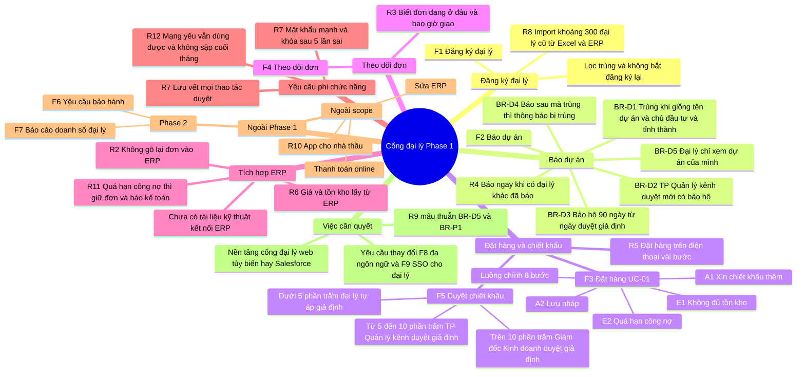

## Mind map: Cổng đại lý Phase 1
**Nguồn:** ghi chú kickoff dự án Đại Việt Electric · **Mục đích đọc:** cho cả nhóm nhìn phạm vi trên một trang trước khi phỏng vấn · **Quy ước:** nhãn "giả định" = nội dung chưa có nguồn xác nhận

### Sơ đồ

### Bảng nhánh
| Nhánh | Nội dung chính | Nguồn (mã) |
|---|---|---|
| Đăng ký đại lý | Đăng ký và import khoảng 300 đại lý cũ, lọc trùng | F1, R8 |
| Báo dự án | Báo dự án, chống trùng, duyệt, bảo hộ, phạm vi xem | F2, R4, BR-D1 đến BR-D5 |
| Đặt hàng và chiết khấu | Luồng đặt hàng, nhánh phụ và ngoại lệ, ngưỡng duyệt chiết khấu | F3, UC-01, R5, F5, BR-C1 |
| Theo dõi đơn | Đại lý xem trạng thái và ngày giao | F4, R3 |
| Tích hợp ERP | Không gõ lại đơn, giá và tồn kho từ ERP, kiểm công nợ | R2, R6, R11, BR-C2, BR-C7 |
| Yêu cầu phi chức năng | Bảo mật, lưu vết, hiệu năng, mạng yếu | R7, R12 |
| Ngoài Phase 1 | Phase 2 và các mục out of scope | F6, F7 (theo case), R10 |
| Việc cần quyết | Nền tảng, mâu thuẫn R9 với BR-D5, thay đổi F8 và F9 | R9, BR-D5, BR-P1, F8, F9 |

### Nhánh còn trống hoặc thiếu nguồn
| Nhánh / nút | Thiếu gì | Hỏi ai |
|---|---|---|
| Đăng ký đại lý, F1 | Chưa có quy trình đăng ký (ai duyệt hồ sơ, hồ sơ gồm gì) | Chị Hạnh |
| Theo dõi đơn, F4 | Chưa có danh sách trạng thái đơn đầy đủ và cách báo ngày giao | Chị Hạnh, chị Loan |
| Tích hợp ERP | Chưa có tài liệu kỹ thuật kết nối ERP | Chị Loan |
| Yêu cầu phi chức năng, R12 | Chưa có con số cụ thể cho tốc độ mở trang và tải cuối tháng | Anh Kiên, anh Quang |
| Ngoài Phase 1, Phase 2 | F6 và F7 chưa có nội dung chi tiết trong ghi chú | Anh Dũng (bảo hành), anh Quang (báo cáo) |
| Việc cần quyết | R9 mâu thuẫn BR-D5 và BR-P1; F8 đã out of scope nhưng lại được yêu cầu | Anh Quang |

### Gợi ý dùng tiếp
- Báo dự án và Đặt hàng và chiết khấu → build-glossary (chốt "dự án", "bảo hộ", "trùng", "duyệt") rồi sang use case UC-01.
- Việc cần quyết (R9 so với BR-D5, F8, F9) → plan-requirements-workshop.
- Tích hợp ERP, Theo dõi đơn → prepare-stakeholder-interview với chị Loan và chị Hạnh.

### Câu hỏi mở
1. F5 (duyệt chiết khấu) thuộc Phase 1 hay Phase 2? Ghi chú chỉ gắn F5 với luồng đặt hàng, chưa nêu phase. (cần: anh Quang, chị Hạnh)
2. Các ngưỡng chiết khấu 5% và 10% (BR-C1) đã có văn bản chính sách chưa? (cần: chị Hạnh, anh Quang)
3. Nền tảng cổng đại lý sẽ chọn web tùy biến hay Salesforce, và ai quyết, khi nào? (cần: anh Quang, anh Kiên)
4. R9 sẽ được xử lý theo hướng nào so với BR-D5 và phân quyền theo vùng? (cần: anh Quang, anh Kiên)
5. Phase 2 (bảo hành, báo cáo doanh số) có giữ nguyên hai tính năng F6, F7 hay thay đổi sau khi Phase 1 xong? (cần: anh Quang)
