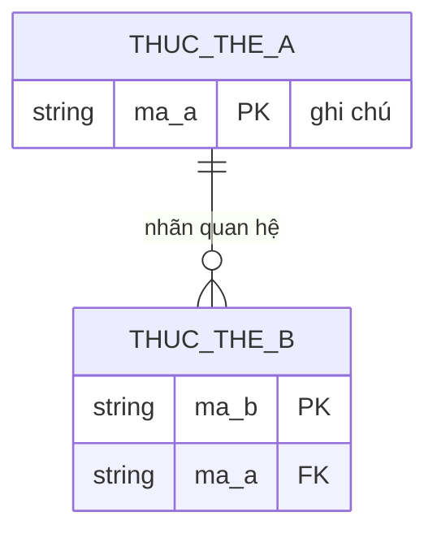

# Mô hình hóa dữ liệu (Data Modelling)

## 1. Mục đích
Data Modelling mô tả dữ liệu mà nghiệp vụ cần ghi nhớ: có những loại "thứ" nào (entity), mỗi thứ mang thông tin gì (attribute) và chúng liên hệ với nhau ra sao (relationship, cardinality). Skill này dựng bản logical, đủ để BA, dev và người dùng nghiệp vụ cùng đọc, chưa quyết định bảng hay object của nền tảng nào. Giá trị chính là lộ sớm ba thứ: thực thể trùng nghĩa, chỗ thiếu khóa, và dữ liệu có hai nguồn (hệ thống ngoài so với hệ thống mới).

## 2. Đầu vào cần có
- Spec hoặc yêu cầu đã có (business rule, use case, user story hoặc đoạn mô tả nghiệp vụ). Bắt buộc.
- Danh sách danh từ nghiệp vụ, hoặc glossary từ `build-glossary`. Bắt buộc.
- Hệ thống nguồn của từng nhóm dữ liệu (ERP, SSO, file Excel...). Bắt buộc nếu có hệ thống ngoài, vì quyết định câu 4 của checklist.
- Nền tảng đã chốt hay chưa. Tùy chọn; chưa chốt thì giữ logical và ghi rõ.
- Yêu cầu lưu vết, quy mô dữ liệu. Tùy chọn.

Thiếu đầu vào bắt buộc nào thì **hỏi lại người dùng trước khi làm**. Không tự bịa để lấp chỗ trống.

## 3. Các bước
1. Gạch danh từ trong spec, đối chiếu với danh sách danh từ. Gộp từ đồng nghĩa, loại danh từ chỉ là giá trị hoặc thuộc tính.
2. Danh từ có vòng đời, người duyệt hoặc lịch sử riêng thì là thực thể; còn lại là thuộc tính. Ghi mô tả một dòng cho mỗi thực thể. Luôn có thực thể cho người duyệt/người phụ trách (ví dụ NHAN_VIEN) hoặc ghi rõ lý do bỏ.
3. Gán thuộc tính từ spec. Giá trị tính được (tổng tiền, ngày hết hạn) ghi là trường tính, không lưu.
4. Chọn khóa chính (mã nghiệp vụ hoặc mã sinh) và khóa ngoại. Khóa tự nhiên không tin được (như tên dự án) chỉ dùng để phát hiện trùng, không làm khóa chính.
5. Xác định quan hệ và cardinality, tách quan hệ nhiều-nhiều bằng thực thể trung gian.
6. Đánh dấu nguồn từng trường quan trọng: hệ thống ngoài (chỉ đọc) hay hệ thống mới sở hữu.
7. Chuẩn hóa tối thiểu: không nhóm trường lặp, không lưu dữ liệu tính được (hoặc ghi lý do), thuộc tính phụ thuộc đúng khóa của thực thể.
8. Vẽ Mermaid, trả lời 6 câu checklist. Câu nào "Cần hỏi" thì chuyển xuống Câu hỏi mở.

Cú pháp Mermaid và lỗi thường gặp: `references/mermaid-erd-cheatsheet.md`.

## 4. Mẫu đầu ra
````markdown
# Mô hình dữ liệu logical: <phạm vi>

## 1. Phạm vi và giả định
- Phạm vi: <thực thể/chức năng được vẽ, cái gì để ngoài>
- Mức mô hình: logical, chưa gắn nền tảng <ghi nền tảng nào chưa chốt>
- Nguồn dữ liệu: <hệ thống ngoài và phần nào suy luận, gắn [GIẢ ĐỊNH]>

## 2. ERD (Mermaid)


## 3. Mô tả thực thể và quan hệ
### 3.1 Thực thể
| Thực thể | Ý nghĩa | Khóa chính | Khóa ngoại | Nguồn dữ liệu chính | Ghi chú |
|---|---|---|---|---|---|
### 3.2 Quan hệ
| Quan hệ | Cardinality | Giải thích | Căn cứ |
|---|---|---|---|

## 4. Checklist 6 câu
| # | Câu hỏi | Trả lời (chỉ Có/Không/Cần hỏi) | Ghi chú |
|---|---|---|---|
| 1 | Có thực thể nào trùng nghĩa (hai tên cho cùng một thứ)? | | |
| 2 | Mỗi thực thể có khóa chính, và mọi khóa ngoại trỏ đúng đích? | | |
| 3 | Mọi quan hệ nhiều-nhiều đã tách bằng thực thể trung gian? | | |
| 4 | Trường nào lấy từ ERP/hệ thống ngoài (chỉ đọc), trường nào do hệ thống mới sở hữu? | | |
| 5 | Dữ liệu lịch sử và vết duyệt có chỗ lưu, không bị ghi đè? | | |
| 6 | Thực thể/trường nào nhạy cảm, cần phân quyền hoặc che? | | |

### Câu hỏi mở
1. <câu hỏi, ghi rõ cần ai trả lời>
````

## 5. Tự kiểm trước khi trả kết quả
- [ ] Mọi thực thể có khóa chính; mọi khóa ngoại trỏ về một khóa chính có trong ERD?
- [ ] Mọi quan hệ có cardinality và nhãn; không còn quan hệ nhiều-nhiều chưa tách?
- [ ] Chuẩn hóa tối thiểu: không trường lặp, không trường tính được bị lưu mà thiếu lý do?
- [ ] Tên thực thể/trường bám danh từ trong đầu vào; thực thể thêm ngoài danh sách đã nói rõ lý do?
- [ ] Mermaid hợp lệ (tên không dấu, không khoảng trắng; nhãn trong ngoặc kép) và không dùng tên API của nền tảng?
- [ ] Cả 6 câu checklist có trả lời; mọi "Cần hỏi" đã có trong Câu hỏi mở?

## 6. BA phải verify
- Cardinality: AI hay mặc định 1-n. Xác nhận với người dùng nghiệp vụ (một đại lý có đúng một sales phụ trách không?).
- Cột nguồn ERP: AI chỉ suy từ nghiệp vụ, không biết ERP thật chứa gì. Phải đối chiếu tài liệu ERP hoặc chủ hệ thống.
- Ranh giới thực thể và thuộc tính (ví dụ phê duyệt là bảng riêng hay vài cột trong đơn).
- Thực thể AI thêm ngoài danh sách (như nhân viên nội bộ) có thật sự cần không, hoặc lý do bỏ có hợp lý không.
- Render Mermaid trên công cụ đang dùng trước khi gửi đi.

## 7. An toàn dữ liệu
- Không đưa dữ liệu khách hàng thật vào. Dùng dữ liệu đã ẩn danh; ERD chỉ cần tên trường, không cần giá trị thật.
- Gắn nhãn `[GIẢ ĐỊNH]` cho mọi trường, giá trị liệt kê, quan hệ không có nguồn trong đầu vào.
- Trường nhạy cảm (thông tin liên hệ, chiết khấu, khách của đại lý) chỉ gắn nhãn ở câu 6; không điền giá trị thật làm ví dụ.

## 8. Câu hỏi mở
Luôn kết thúc đầu ra bằng mục này:

```
### Câu hỏi mở
1. <câu hỏi còn thiếu, ghi rõ cần ai trả lời>
```
