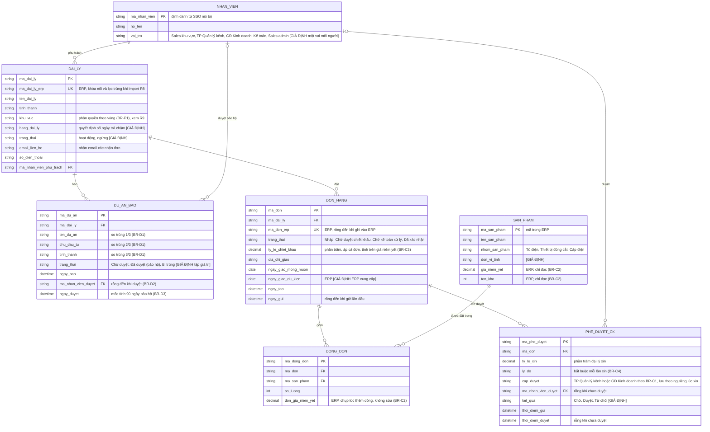

# Mô hình dữ liệu logical: Cổng đại lý Đại Việt Electric (Phase 1: báo dự án, đặt hàng, duyệt chiết khấu)

## 1. Phạm vi và giả định
- Phạm vi: 6 thực thể được yêu cầu (Đại lý, Dự án đã báo, Đơn hàng, Dòng đơn, Sản phẩm, Phê duyệt chiết khấu) và 1 thực thể hỗ trợ thêm là Nhân viên nội bộ (cần để trả lời "ai duyệt", "ai phụ trách"). Để ngoài: bảo hành, báo cáo doanh số (Phase 2), công nợ chi tiết (nằm ở ERP).
- Mức mô hình: logical, chưa gắn nền tảng. Nền tảng cổng đại lý chưa chốt (web tùy biến hay Salesforce) nên tên trong ERD là tên nghiệp vụ, không phải tên bảng hay object; kiểu dữ liệu là kiểu chung (`string`, `int`, `decimal`, `date`, `datetime`). Khi chốt nền tảng sẽ chuyển sang physical.
- Nguồn dữ liệu: ERP giữ giá niêm yết, tồn kho, đơn hàng chính thức, công nợ (BR-C2, UC-01). SSO nội bộ giữ tài khoản nhân viên. Tài liệu kỹ thuật ERP chưa có nên cột "ERP" trong ERD là suy luận từ nghiệp vụ `[GIẢ ĐỊNH]`.
- Mọi trạng thái ngoài 4 trạng thái của UC-01, và mọi thuộc tính không có trong spec (hạng đại lý, đơn vị tính, thông tin liên hệ) đều gắn `[GIẢ ĐỊNH]`.

## 2. ERD (Mermaid)

## 3. Mô tả thực thể và quan hệ
### 3.1 Thực thể
| Thực thể | Ý nghĩa | Khóa chính | Khóa ngoại | Nguồn dữ liệu chính | Ghi chú |
|---|---|---|---|---|---|
| NHAN_VIEN (Nhân viên nội bộ) | Người dùng nội bộ: sales khu vực, TP Quản lý kênh, GĐ Kinh doanh, Kế toán | ma_nhan_vien | không | SSO nội bộ | Thực thể thêm ngoài danh sách yêu cầu, để lưu "ai" cho phê duyệt và phụ trách |
| DAI_LY (Đại lý) | Đối tác ký hợp đồng theo năm, đặt hàng và báo dự án | ma_dai_ly | ma_nhan_vien_phu_trach | Cổng (hồ sơ), ERP (mã khách hàng) | Master hồ sơ chưa rõ ở đâu (câu hỏi mở 3) |
| DU_AN_BAO (Dự án đã báo) | Dự án đại lý báo để xin bảo hộ | ma_du_an | ma_dai_ly, ma_nhan_vien_duyet | Cổng | Bộ ba (ten_du_an, chu_dau_tu, tinh_thanh) chỉ để phát hiện trùng, không làm khóa. Ngày hết bảo hộ = ngay_duyet + 90 ngày `[GIẢ ĐỊNH]`, tính, không lưu |
| DON_HANG (Đơn hàng) | Một lần đặt hàng của đại lý | ma_don | ma_dai_ly | Cổng (bản đặt), ERP (ma_don_erp, ngay_giao_du_kien) | Tổng tiền là trường tính từ DONG_DON, không lưu. ngay_gui giữ lần gửi gần nhất: đơn quay về Nháp do E3 (ERP không phản hồi khi ghi đơn) vẫn có ngay_gui `[GIẢ ĐỊNH]` |
| DONG_DON (Dòng đơn) | Một sản phẩm với số lượng trong một đơn | ma_dong_don | ma_don, ma_san_pham | Cổng; đơn giá từ ERP | Cặp (ma_don, ma_san_pham) không lặp `[GIẢ ĐỊNH]`. Đơn giá chụp lúc thêm dòng để đơn không đổi khi giá niêm yết đổi |
| SAN_PHAM (Sản phẩm) | Hàng đặt được, thuộc 3 nhóm | ma_san_pham | không | ERP | Cổng chỉ đọc, không ai sửa giá và tồn kho (BR-C2) |
| PHE_DUYET_CK (Phê duyệt chiết khấu) | Mỗi lần xin chiết khấu và quyết định | ma_phe_duyet | ma_don, ma_nhan_vien_duyet | Cổng | Mỗi lần xin một dòng mới, không ghi đè; chỉ tạo khi chiết khấu từ 5% trở lên (ngưỡng BR-C1 `[GIẢ ĐỊNH]`) |

### 3.2 Quan hệ
| Quan hệ | Cardinality | Giải thích | Căn cứ |
|---|---|---|---|
| NHAN_VIEN – DAI_LY | 1 – 0..n | Mỗi đại lý có đúng một sales phụ trách; một sales phụ trách nhiều đại lý `[GIẢ ĐỊNH]` | Spec: sales khu vực phụ trách đại lý |
| DAI_LY – DU_AN_BAO | 1 – 0..n | Một đại lý báo nhiều dự án | BR-D5 |
| DAI_LY – DON_HANG | 1 – 0..n | Một đại lý có nhiều đơn | UC-01 |
| DON_HANG – DONG_DON | 1 – 0..n | Đơn Nháp có thể chưa có dòng; khi gửi phải có ít nhất 1 dòng `[GIẢ ĐỊNH]` | UC-01 bước 3 |
| SAN_PHAM – DONG_DON | 1 – 0..n | Quan hệ nhiều-nhiều giữa đơn và sản phẩm, tách qua DONG_DON | UC-01 |
| DON_HANG – PHE_DUYET_CK | 1 – 0..n | Một đơn có thể xin chiết khấu nhiều lần (bị từ chối rồi xin lại) `[GIẢ ĐỊNH]` | BR-C4, BR-C5 |
| NHAN_VIEN – PHE_DUYET_CK | 0..1 – 0..n | Người duyệt rỗng đến khi có quyết định | BR-C5, R7 |
| NHAN_VIEN – DU_AN_BAO | 0..1 – 0..n | Người duyệt rỗng đến khi TP Quản lý kênh duyệt | BR-D2 |

## 4. Checklist 6 câu
| # | Câu hỏi | Trả lời (chỉ Có/Không/Cần hỏi) | Ghi chú |
|---|---|---|---|
| 1 | Có thực thể nào trùng nghĩa (hai tên cho cùng một thứ)? | Cần hỏi | "Đại lý" của cổng và "khách hàng" của ERP coi là một, nối bằng ma_dai_ly_erp `[GIẢ ĐỊNH]`. "Đơn hàng" cổng và đơn ERP là cùng một đơn, nối bằng ma_don_erp. Duyệt dự án và duyệt chiết khấu giữ riêng vì khác đối tượng, người duyệt, quy tắc |
| 2 | Mỗi thực thể có khóa chính, và mọi khóa ngoại trỏ đúng đích? | Có | 7/7 thực thể có PK; 8 khóa ngoại đều trỏ về PK trong ERD. Mã sinh là `[GIẢ ĐỊNH]`, chưa có quy tắc đặt mã |
| 3 | Mọi quan hệ nhiều-nhiều đã tách bằng thực thể trung gian? | Có | Đơn hàng – Sản phẩm tách qua DONG_DON. Nhân viên – Đại lý đang là 1-n; nếu một đại lý có nhiều sales thì phải tách thêm |
| 4 | Trường nào lấy từ ERP/hệ thống ngoài (chỉ đọc), trường nào do hệ thống mới sở hữu? | Có | ERP: gia_niem_yet, ton_kho, don_gia_niem_yet (chụp), ma_don_erp, ma_dai_ly_erp, ngay_giao_du_kien. Cổng: dự án, phê duyệt, trạng thái đơn trước khi ghi ERP. Công nợ chỉ hỏi ERP khi gửi đơn, không lưu |
| 5 | Dữ liệu lịch sử và vết duyệt có chỗ lưu, không bị ghi đè? | Cần hỏi | Đã có một phần: PHE_DUYET_CK lưu mỗi lần xin kèm người duyệt và thời điểm (BR-C5, R7); DU_AN_BAO lưu người duyệt và ngày duyệt. Chưa có chỗ lưu lịch sử đổi trạng thái đơn, cần cho F4 Theo dõi đơn |
| 6 | Thực thể/trường nào nhạy cảm, cần phân quyền hoặc che? | Có | DU_AN_BAO (chủ đầu tư, tên dự án; đại lý cần giữ kín khách của mình, BR-D5). ty_le_chiet_khau và PHE_DUYET_CK (đại lý khác không được thấy). email_lien_he, so_dien_thoai của DAI_LY. Phạm vi xem theo khu_vuc đang vướng R9, BR-D5 và BR-P1 (phân quyền theo vùng `[GIẢ ĐỊNH]`, chưa có văn bản) |

### Câu hỏi mở
1. ERP có cấp mã khách hàng cho đại lý và mã đơn như giả định không? Giá niêm yết, tồn kho truy vấn trực tiếp hay đồng bộ về cổng? (Chị Loan, cần tài liệu kỹ thuật kết nối ERP)
2. Nền tảng cổng chưa chốt: khi chốt, ma_*, kiểu dữ liệu và quan hệ sẽ chuyển sang physical thế nào? (Anh Quang chốt quyết định; Architect đánh giá)
3. Hồ sơ đại lý do ERP hay cổng làm master? Trường nào đại lý được tự sửa? (Chị Hạnh và Chị Loan)
4. Một đại lý có một hay nhiều sales khu vực phụ trách? Sales xem vùng khác (R9) có đúng không, và BR-P1 phân quyền theo vùng áp thế nào, khi BR-D5 giới hạn đại lý chỉ xem dự án của mình? (Anh Quang và Chị Hạnh)
5. Đại lý có nhiều tài khoản người dùng không? Nếu có cần thêm thực thể người dùng đại lý để lưu "ai đặt, ai báo". (Chị Hạnh, Anh Kiên)
6. Tính trùng dự án (BR-D1) so khớp tuyệt đối hay chuẩn hóa dấu, viết tắt, hoa thường? Dự án bị trùng có lưu lại hay bị từ chối ngay? (Chị Hạnh)
7. Đơn hàng có gắn với một dự án đã báo (bán theo dự án) không? Nếu có cần thêm khóa ngoại từ DON_HANG đến DU_AN_BAO. (Chị Hạnh)
8. Cần lịch sử đổi trạng thái đơn cho F4 và danh sách trạng thái đầy đủ (đang giao, đã giao, hủy)? (Anh Nhân và Chị Hạnh)
