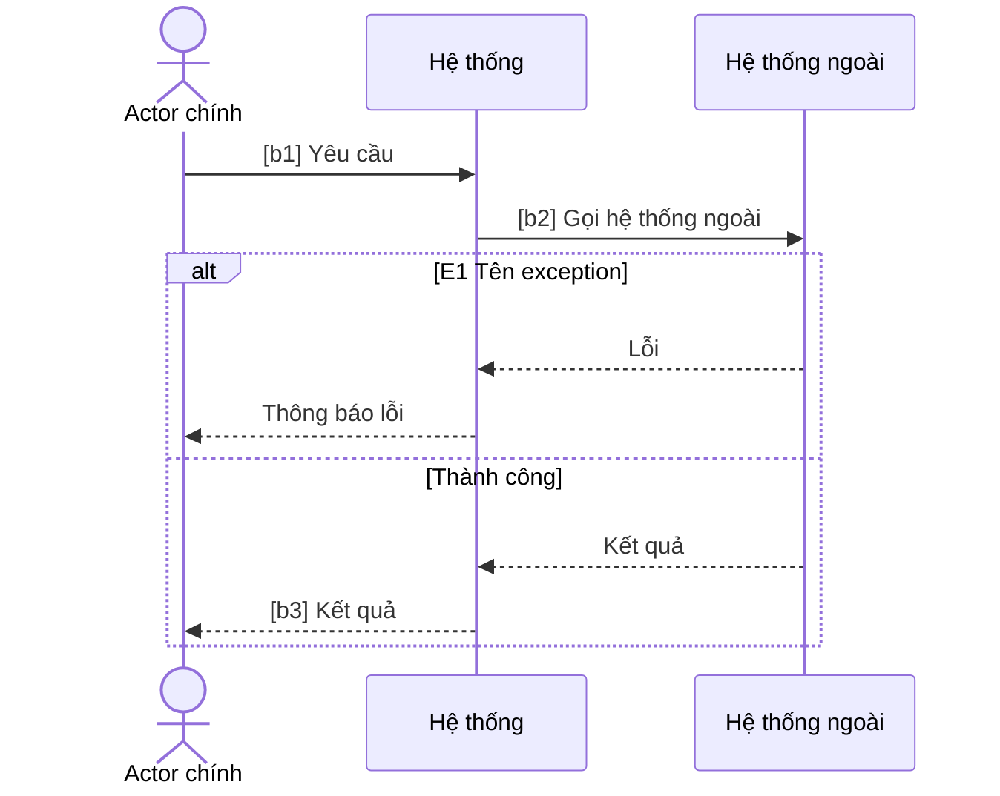

# Sơ đồ tuần tự (Sequence Diagrams)

## 1. Mục đích
Sequence Diagram (UML) cho thấy các bên tham gia trao đổi thông điệp theo thứ tự thời gian để thực hiện một kịch bản: ai gọi ai, theo thứ tự nào, nhận lại gì, rẽ nhánh khi nào. BA dùng nó để làm rõ tích hợp và trách nhiệm của từng hệ thống trước khi dev thiết kế. Skill này chuyển main flow và các luồng A/E của một use case thành sơ đồ Mermaid, giữ nguyên mã bước và mã luồng để truy vết ngược về spec.

## 2. Đầu vào cần có
- Use case spec (main flow, alternative, exception với mã bước và mã luồng ổn định).
- Danh sách hệ thống và actor liên quan (hệ thống đang xây, hệ thống ngoài).
- Luồng nào cần vẽ: chỉ main flow hay thêm A/E nào. Nếu không nói, hỏi lại. Người dùng chỉ nói "vẽ sơ đồ" mà không nêu loại thì hỏi lại loại sơ đồ (quy trình, tuần tự hay trạng thái).
- Tùy chọn: thông tin tích hợp (đồng bộ hay bất đồng bộ, thời gian chờ, tài liệu kỹ thuật).

Thiếu đầu vào bắt buộc nào thì **hỏi lại người dùng trước khi làm**. Không tự bịa để lấp chỗ trống.

## 3. Các bước
1. Đọc spec, lấy actor, hệ thống ngoài, main flow và các A/E được yêu cầu vẽ. Chốt phạm vi sơ đồ và ghi rõ luồng nào không vẽ.
2. Chọn participant. Người là `actor`, hệ thống là `participant`. Thứ tự từ trái sang phải: actor chính, hệ thống đang xây, hệ thống ngoài, actor nhận thông báo.
3. Chuyển từng bước main flow thành message: `->>` là yêu cầu, `-->>` là phản hồi. Bước chỉ có actor với hệ thống thì vẽ một cặp; bước nội bộ của hệ thống dùng self-message.
4. Gắn mã bước vào nhãn message dạng `[b3]` để truy vết (bước đã tách thì `[b7a]`, `[b7b]`). Message không ứng với bước nào (ví dụ phản hồi từ ERP) không cần mã.
5. Với mỗi A/E được vẽ, dùng `alt` cho rẽ nhánh thay thế, `opt` cho bước tùy chọn, `loop` cho quay lại. Tên khối là mã luồng và tên (ví dụ `E2 Quá hạn công nợ`), nhánh `else` là luồng chính hoặc luồng còn lại.
6. Với mỗi lần gọi hệ thống ngoài, ghi giả định đồng bộ hay bất đồng bộ và xử lý khi không phản hồi. Input không nói thì gắn `[GIẢ ĐỊNH]`.
7. Lập bảng truy vết message về bước hoặc luồng của use case.
8. Soát cú pháp theo `references/mermaid-sequence-cheatsheet.md`, kết thúc bằng "Câu hỏi mở".

## 4. Mẫu đầu ra
````markdown
## Sequence diagram: <UC-xx tên>
**Phạm vi**: Vẽ: <main flow, A/E nào> · Không vẽ: <A/E nào, lý do> · Nguồn: <spec, phiên bản>

### Participant
| Participant | Loại | Vai trò | Nguồn |
|---|---|---|---|

### Sơ đồ


### Truy vết message về use case
| Message (rút gọn) | Bước / luồng UC | Đồng bộ? | Ghi chú |
|---|---|---|---|

### Giả định về tích hợp
- <giả định, gắn [GIẢ ĐỊNH]>

### Câu hỏi mở
1. <câu hỏi, ghi rõ cần ai trả lời>
````

## 5. Tự kiểm trước khi trả kết quả
- [ ] Mọi bước main flow có tương tác giữa hai participant đều xuất hiện, đúng thứ tự trong spec?
- [ ] Mỗi khối `alt` có tên là mã luồng thật sự tồn tại trong spec (A1, E2...), không bịa mã?
- [ ] Mỗi lần gọi hệ thống ngoài đều có phản hồi hoặc ghi chú rõ khi không có phản hồi?
- [ ] Mọi `alt`, `opt`, `loop` đều có `end`; không có `;` hoặc `#` trong nhãn message?
- [ ] Bảng truy vết phủ hết message có mã bước, và phần "Không vẽ" nêu lý do?
- [ ] Participant nào không có message nào đã bị bỏ?

## 6. BA phải verify
- Ai gọi ai: AI hay đặt sai chiều gọi giữa cổng và ERP, hoặc cho ERP chủ động đẩy dữ liệu khi thực tế là cổng hỏi.
- Đồng bộ hay bất đồng bộ, thời gian chờ, thử lại: input hiếm khi có, mọi chỗ này là `[GIẢ ĐỊNH]` cần dev xác nhận.
- Thứ tự kiểm tra (công nợ trước hay ghi đơn trước) và việc ERP có cung cấp từng lệnh gọi tách rời hay không.
- Luồng bị bỏ khỏi sơ đồ có đúng là luồng không cần vẽ, không bị bỏ vì khó.

## 7. An toàn dữ liệu
- Không đưa dữ liệu khách hàng thật vào. Dùng dữ liệu đã ẩn danh.
- Gắn nhãn `[GIẢ ĐỊNH]` cho mọi rule, số liệu, tên riêng không có nguồn trong đầu vào.
- Không ghi URL, endpoint, khóa API hoặc tên bảng thật của hệ thống ngoài vào nhãn message; dùng mô tả nghiệp vụ.

## 8. Câu hỏi mở
Luôn kết thúc đầu ra bằng mục này:

```
### Câu hỏi mở
1. <câu hỏi còn thiếu, ghi rõ cần ai trả lời>
```
