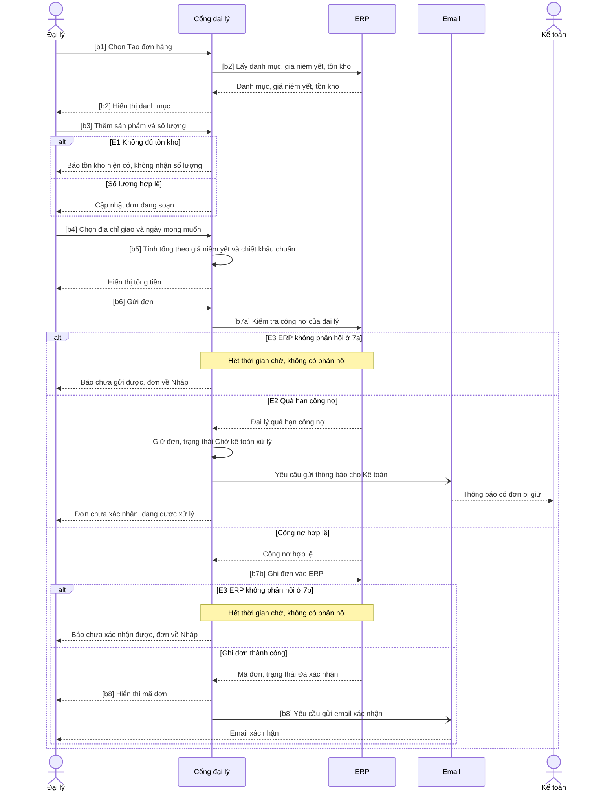

## Sequence diagram: UC-01 Đặt hàng
**Phạm vi**: Vẽ: main flow (bước 1-8, tách 7a/7b), E1, E2, E3 (ở 7a và 7b) · Không vẽ: A1 (cần sơ đồ riêng cho F5 vì có người duyệt), A2 (chỉ Cổng đại lý, không tương tác hệ thống ngoài), E4 (lỗi giữa thiết bị và cổng, không có hệ thống ngoài), E5 (ERP không phản hồi ở bước 2: use case dừng ngay, chưa có đơn, không có "Nháp") · Nguồn: spec UC-01 trong đầu vào

### Participant
| Participant | Loại | Vai trò | Nguồn |
|---|---|---|---|
| Đại lý | actor | Tạo và gửi đơn | UC-01 actor chính |
| Cổng đại lý | participant | Hệ thống đang xây, điều phối đơn; spec UC-01 gọi là "Hệ thống" | Case, dự án Phase 1 |
| ERP | participant | Cung cấp giá niêm yết, tồn kho, công nợ; nhận đơn | Case, hệ thống ngoài |
| Email | participant | Gửi email xác nhận và thông báo | Case, hệ thống ngoài |
| Kế toán | actor | Nhận thông báo đơn bị giữ | UC-01 E2 |

### Sơ đồ

### Truy vết message về use case
| Message (rút gọn) | Bước / luồng UC | Đồng bộ? | Ghi chú |
|---|---|---|---|
| Chọn Tạo đơn hàng | Bước 1 | n/a | Trigger |
| Lấy danh mục, giá, tồn kho từ ERP | Bước 2 | Đồng bộ `[GIẢ ĐỊNH]` | Giá do ERP cấp, cổng không sửa (BR-C2) |
| Báo tồn kho hiện có | E1 (bước 3) | Nội bộ cổng | So với tồn kho đã lấy ở bước 2 `[GIẢ ĐỊNH]` |
| Chọn địa chỉ giao, ngày mong muốn | Bước 4 | n/a | |
| Tính tổng | Bước 5 | Nội bộ cổng | |
| Gửi đơn | Bước 6 | n/a | |
| Kiểm tra công nợ | Bước 7a | Đồng bộ `[GIẢ ĐỊNH]` | Spec tách 7a và 7b |
| Báo chưa gửi được, đơn về Nháp | E3 (bước 7, ở 7a) | Nội bộ cổng | E3 do BA đề xuất `[GIẢ ĐỊNH]` |
| Giữ đơn, thông báo Kế toán, báo đại lý | E2 (bước 7, ở 7a) | Email bất đồng bộ `[GIẢ ĐỊNH]` | Đơn giữ tại cổng, chưa ghi ERP; BR-C7 |
| Ghi đơn vào ERP | Bước 7b | Đồng bộ `[GIẢ ĐỊNH]` | BR-C6: chỉ ghi khi không còn chờ duyệt chiết khấu |
| Báo chưa xác nhận được, đơn về Nháp | E3 (bước 7, ở 7b) | Nội bộ cổng | Phải kiểm tra đơn đã có trong ERP trước khi gửi lại |
| Hiển thị mã đơn, gửi email xác nhận | Bước 8 | Email bất đồng bộ `[GIẢ ĐỊNH]` | Lỗi gửi email không làm hỏng đơn `[GIẢ ĐỊNH]` |

### Giả định về tích hợp
- Cổng gọi ERP theo kiểu chờ phản hồi và có thời gian chờ tối đa; giá trị chưa biết `[GIẢ ĐỊNH]`.
- Email gửi bất đồng bộ qua dịch vụ gửi thư; cổng không chờ kết quả `[GIẢ ĐỊNH]`.
- Thông báo cho Kế toán đi bằng Email, không qua kênh khác `[GIẢ ĐỊNH]`.
- Tách 7a và 7b là từ spec UC-01; việc ERP có lệnh kiểm tra công nợ riêng hay không vẫn chưa xác nhận (xem câu hỏi mở 1).

### Câu hỏi mở
1. ERP có lệnh kiểm tra công nợ riêng (7a) tách khỏi lệnh ghi đơn (7b) không? Tài liệu kết nối ERP khi nào có? (Chị Loan)
2. Thời gian chờ tối đa khi gọi ERP và có tự thử lại không? (Chị Loan, dev)
3. Nếu ERP đã nhận đơn ở 7b nhưng không kịp phản hồi, cổng làm sao biết để không ghi đơn trùng khi đại lý gửi lại? (Chị Loan, dev)
4. Email xác nhận gửi lỗi thì có thử lại hoặc báo cho ai không? (Anh Kiên)
5. Thông báo cho Kế toán đi bằng Email hay kênh khác, và gửi cho một người hay một nhóm? (Chị Loan)
6. Có cần vẽ riêng sequence cho A1 (xin chiết khấu và duyệt, F5) và cho E5 (bước 2) không? (BA, Chị Hạnh)
