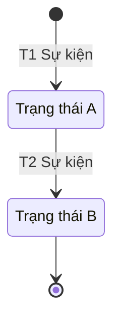

# Mô hình trạng thái (State Modelling)

## 1. Mục đích
State Modelling mô tả các trạng thái mà một đối tượng nghiệp vụ có thể ở trong suốt vòng đời, và những sự kiện làm nó chuyển từ trạng thái này sang trạng thái khác, kèm điều kiện và hành động đi theo. BA dùng nó để biến business rule rải rác thành một vòng đời duy nhất, tìm ra chuyển trạng thái bị thiếu hoặc bị cấm, và làm gốc cho trường trạng thái, phân quyền, thông báo. Skill này dựng stateDiagram-v2 và bảng chuyển trạng thái có mã `T1, T2...` để user story và test case trích dẫn.

## 2. Đầu vào cần có
- Entity cần mô hình hóa và thuộc tính chính của nó.
- Business rule liên quan đến trạng thái (điều kiện, thời hạn, ai được làm gì).
- Actor và hệ thống có thể kích hoạt thay đổi (kể cả bộ đếm thời gian tự động).
- Tùy chọn: use case spec có tên trạng thái cuối luồng (nên có, để nối chuỗi Use Case → State), user story, thuật ngữ trong glossary. Người dùng chỉ nói "vẽ sơ đồ" mà không nêu loại thì hỏi lại loại sơ đồ.

Thiếu đầu vào bắt buộc nào thì **hỏi lại người dùng trước khi làm**. Không tự bịa để lấp chỗ trống.

## 3. Các bước
1. Chốt entity và ranh giới vòng đời: bắt đầu từ lúc nào, kết thúc ở đâu.
2. Rút trạng thái từ rule: trạng thái là tình trạng bền vững của đối tượng (thường "Chờ...", "Đang...", "Đã..."), không phải hành động. Đặt tên theo từ vựng của nghiệp vụ.
3. Xác định trạng thái đầu và trạng thái cuối (có thể nhiều trạng thái cuối).
4. Liệt kê chuyển trạng thái, đánh mã `T1, T2...`: trạng thái nguồn, sự kiện, guard (điều kiện), trạng thái đích, hành động đi kèm, ai hoặc hệ thống kích hoạt. Nếu đầu vào có use case spec, điền cột "Luồng UC" bằng mã bước hoặc luồng của spec (ví dụ `A2`, `E2`, `7a`); chưa có UC thì ghi `—`.
5. Rà soát: trạng thái nào không có đường ra (trừ trạng thái cuối) hoặc không có đường vào; hai guard cùng xuất phát một trạng thái có xung đột không; trạng thái nào có thể "treo" (cần timeout).
6. Liệt kê các chuyển trạng thái không cho phép, kèm lý do.
7. Vẽ Mermaid theo `references/state-diagram-cheatsheet.md`, nhãn mũi tên bắt đầu bằng mã `T`.
8. Gắn `[GIẢ ĐỊNH]` cho mọi trạng thái, guard, thời hạn không có nguồn. Kết thúc bằng "Câu hỏi mở".

## 4. Mẫu đầu ra
````markdown
## State diagram: <Entity>
**Entity**: <tên, thuộc tính chính> · **Phạm vi vòng đời**: <từ sự kiện nào đến trạng thái cuối nào> · **Phase**: <nếu có>

### Danh sách trạng thái
| Trạng thái | Ý nghĩa | Loại (đầu / giữa / cuối) | Nguồn rule |
|---|---|---|---|

### Sơ đồ


### Bảng chuyển trạng thái
| Mã | Từ | Sự kiện | Guard | Đến | Hành động | Kích hoạt bởi | Luồng UC | Nguồn |
|---|---|---|---|---|---|---|---|---|

### Chuyển trạng thái không cho phép
- <từ → đến: lý do>

### Câu hỏi mở
1. <câu hỏi, ghi rõ cần ai trả lời>
````

## 5. Tự kiểm trước khi trả kết quả
- [ ] Mỗi trạng thái trong sơ đồ có mặt trong bảng trạng thái, và mỗi mũi tên có một dòng `T` trong bảng chuyển?
- [ ] Có đúng một trạng thái đầu, ít nhất một trạng thái cuối, và không có trạng thái cụt ngoài trạng thái cuối?
- [ ] Các guard xuất phát từ cùng một trạng thái có loại trừ nhau hoặc có thứ tự ưu tiên ghi rõ?
- [ ] Tên trạng thái là tình trạng (không phải hành động), khớp từ vựng nghiệp vụ và tên trạng thái ở cuối luồng trong spec; cột Luồng UC dùng đúng mã của spec?
- [ ] Có xử lý thời hạn và hủy bỏ (timer, đại lý hủy) nếu rule nhắc tới?
- [ ] Id trạng thái trong Mermaid là ASCII, nhãn tiếng Việt khai báo bằng `state "..." as Id`?

## 6. BA phải verify
- Tên và số lượng trạng thái: AI hay tách quá nhỏ (một trạng thái cho mỗi hành động) hoặc gộp quá chung ("Đang xử lý" che nhiều bước thật).
- Ai được kích hoạt chuyển nào, nhất là chuyển tự động theo thời gian và việc hủy ở trạng thái muộn.
- Thời hạn (48 giờ, 18 tháng...) và điều kiện tính mốc bắt đầu, dừng, bắt đầu lại.
- Chuyển nào bị cấm và đối tượng có được mở lại từ trạng thái cuối hay phải tạo mới.

## 7. An toàn dữ liệu
- Không đưa dữ liệu khách hàng thật vào. Dùng dữ liệu đã ẩn danh.
- Gắn nhãn `[GIẢ ĐỊNH]` cho mọi rule, số liệu, tên riêng không có nguồn trong đầu vào.
- Không ghi số serial, mã đơn, tên khách có thật vào bảng; chỉ dùng tên trường.

## 8. Câu hỏi mở
Luôn kết thúc đầu ra bằng mục này:

```
### Câu hỏi mở
1. <câu hỏi còn thiếu, ghi rõ cần ai trả lời>
```
