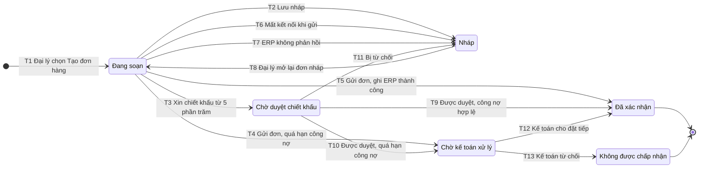

## State diagram: Đơn hàng (UC-01)
**Entity**: Đơn hàng (mã đơn, đại lý, dòng sản phẩm và số lượng, địa chỉ giao, ngày mong muốn, tổng tiền, chiết khấu, trạng thái) · **Phạm vi vòng đời**: từ lúc đại lý chọn "Tạo đơn hàng" đến khi đơn "Đã xác nhận" hoặc không được chấp nhận; các trạng thái sau xác nhận thuộc F4, chưa mô hình hóa · **Phase**: 1 (F3)

### Danh sách trạng thái
| Trạng thái | Ý nghĩa | Loại (đầu / giữa / cuối) | Nguồn rule |
|---|---|---|---|
| Đang soạn | Đại lý đang soạn đơn, chưa gửi và chưa lưu | Đầu | UC-01 bước 1-6; case không nêu tên trạng thái `[GIẢ ĐỊNH]` |
| Nháp | Đơn đã lưu, chưa gửi, chưa ghi vào ERP | Giữa | UC-01 A2, E3, E4 |
| Chờ duyệt chiết khấu | Chờ TP Quản lý kênh hoặc Giám đốc Kinh doanh duyệt, chưa ghi vào ERP | Giữa | UC-01 A1; BR-C1, BR-C6 |
| Chờ kế toán xử lý | Đơn bị giữ vì đại lý quá hạn công nợ, Kế toán đã được thông báo | Giữa | UC-01 E2; BR-C7 |
| Đã xác nhận | Đơn đã ghi vào ERP, đại lý nhận email xác nhận | Cuối (trong phạm vi UC-01) | UC-01 postcondition |
| Không được chấp nhận | Kế toán từ chối đơn bị giữ | Cuối | `[GIẢ ĐỊNH]` |

### Sơ đồ

### Bảng chuyển trạng thái
| Mã | Từ | Sự kiện | Guard | Đến | Hành động | Kích hoạt bởi | Luồng UC | Nguồn |
|---|---|---|---|---|---|---|---|---|
| T1 | (khởi tạo) | Đại lý chọn "Tạo đơn hàng" | Đã đăng nhập, tài khoản hoạt động | Đang soạn | Hiển thị danh mục, giá, tồn kho từ ERP | Đại lý | Bước 1, 2 | UC-01 precondition |
| T2 | Đang soạn | Đại lý lưu nháp | Ở bước 6 | Nháp | Lưu đơn, không kiểm tra công nợ, không ghi ERP | Đại lý | A2 | UC-01 A2 |
| T3 | Đang soạn | Đại lý xin chiết khấu thêm | Mức từ 5% trở lên (dưới 5% đại lý tự áp, không đổi trạng thái) | Chờ duyệt chiết khấu | Gửi yêu cầu cho người duyệt theo ngưỡng; chưa ghi ERP | Đại lý | A1 (bước 5) | BR-C1, BR-C4, BR-C6 |
| T4 | Đang soạn | Đại lý gửi đơn | 7a báo quá hạn công nợ | Chờ kế toán xử lý | Giữ đơn tại cổng, thông báo Kế toán, báo đại lý | Hệ thống | E2 (bước 7, 7a) | BR-C7 |
| T5 | Đang soạn | Đại lý gửi đơn | 7a công nợ hợp lệ và 7b ghi ERP thành công | Đã xác nhận | Hiển thị mã đơn, gửi email xác nhận | Hệ thống | Bước 6, 7a, 7b, 8 | UC-01 postcondition |
| T6 | Đang soạn | Mất kết nối khi gửi | Yêu cầu gửi không tới hệ thống | Nháp | Giữ bản tự lưu để gửi lại | Hệ thống | E4 (bước 6) | `[GIẢ ĐỊNH]` |
| T7 | Đang soạn | ERP không phản hồi | Hết thời gian chờ ở 7a hoặc 7b | Nháp | Báo đại lý thử lại; kiểm tra đơn đã có trong ERP chưa trước khi gửi lại | Hệ thống | E3 (bước 7) | `[GIẢ ĐỊNH]` |
| T8 | Nháp | Đại lý mở lại đơn nháp | | Đang soạn | Tiếp tục từ bước 3 | Đại lý | A2 (bước 3) | `[GIẢ ĐỊNH]` |
| T9 | Chờ duyệt chiết khấu | Người duyệt duyệt | 7a công nợ hợp lệ và 7b ghi ERP thành công | Đã xác nhận | Lưu người duyệt và thời điểm; hiển thị mã đơn, gửi email xác nhận | Người duyệt (TP Quản lý kênh hoặc Giám đốc Kinh doanh) | A1 → 7a, 7b, 8 | BR-C1, BR-C5, BR-C6 |
| T10 | Chờ duyệt chiết khấu | Người duyệt duyệt | 7a báo quá hạn công nợ | Chờ kế toán xử lý | Lưu quyết định duyệt; giữ đơn, thông báo Kế toán | Người duyệt, hệ thống | A1 → E2 (7a) | BR-C5, BR-C7 `[GIẢ ĐỊNH]` đơn tiếp tục từ 7a |
| T11 | Chờ duyệt chiết khấu | Người duyệt từ chối | | Nháp | Lưu quyết định và lý do từ chối; báo đại lý | Người duyệt | A1 | BR-C5 `[GIẢ ĐỊNH]` đích là Nháp |
| T12 | Chờ kế toán xử lý | Kế toán cho đặt tiếp | 7b ghi ERP thành công | Đã xác nhận | Ghi đơn vào ERP, gửi email xác nhận | Kế toán | E2 → 7b, 8 | `[GIẢ ĐỊNH]` |
| T13 | Chờ kế toán xử lý | Kế toán từ chối | | Không được chấp nhận | Báo đại lý | Kế toán | E2 | `[GIẢ ĐỊNH]` |

Ưu tiên khi gửi đơn từ "Đang soạn": T6 (không tới hệ thống) trước, rồi T7 (ERP lỗi), rồi T4 (quá hạn), cuối cùng T5. T2 và T3 xảy ra trước khi gửi nên không xung đột `[GIẢ ĐỊNH]`.

### Chuyển trạng thái không cho phép
- Đã xác nhận → Nháp hoặc Đang soạn: đơn đã ghi vào ERP; sửa hoặc hủy đơn đã xác nhận nằm ngoài UC-01.
- Chờ duyệt chiết khấu → Đã xác nhận khi chưa có quyết định duyệt: vi phạm BR-C6.
- Nháp → Chờ duyệt chiết khấu, Chờ kế toán xử lý hoặc Đã xác nhận trực tiếp: phải qua "Đang soạn" (T8) rồi gửi lại.
- Không được chấp nhận → bất kỳ trạng thái nào: trạng thái cuối `[GIẢ ĐỊNH]`.

### Câu hỏi mở
1. Sau "Đã xác nhận" đơn còn những trạng thái nào (đã giao, đã hủy) và F4 theo dõi đơn dùng chung vòng đời này không? (Anh Nhân, Chị Hạnh)
2. Chiết khấu bị từ chối (T11) thì đơn về "Nháp" hay đại lý được xin lại ngay trên đơn đó, tối đa mấy lần? (Chị Hạnh, Anh Quang)
3. Kế toán từ chối (T13) có tạo trạng thái riêng "Không được chấp nhận" không, hay đơn về "Nháp"? Kế toán xử lý trong bao lâu? (Chị Loan)
4. Nếu ERP không phản hồi sau khi đã duyệt chiết khấu hoặc sau khi Kế toán cho đặt tiếp, đơn về "Nháp" (mất duyệt) hay giữ nguyên trạng thái chờ? (Chị Loan, dev)
5. "Đang soạn" có được lưu tự động (liên quan E4, R12) hay chỉ tồn tại khi đại lý còn mở màn hình? (Anh Kiên, dev)
6. Đơn vừa cần duyệt chiết khấu vừa quá hạn công nợ: kiểm tra công nợ trước hay duyệt trước? (Chị Loan, Chị Hạnh)
