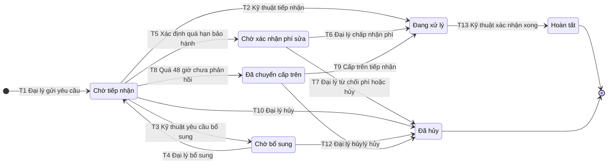

## State diagram: Yêu cầu bảo hành
**Entity**: Yêu cầu bảo hành (mã sản phẩm, serial, ngày mua hoặc mã đơn, mô tả lỗi, ít nhất 2 ảnh, địa chỉ và người liên hệ, thời điểm gửi) · **Phạm vi vòng đời**: từ lúc đại lý gửi yêu cầu đến khi hoàn tất hoặc bị hủy · **Phase**: 2 (F6)

### Danh sách trạng thái
| Trạng thái | Ý nghĩa | Loại (đầu / giữa / cuối) | Nguồn rule |
|---|---|---|---|
| Chờ tiếp nhận | Đã gửi, chờ Kỹ thuật kiểm tra và phản hồi lần đầu; đang đếm 48 giờ | Đầu | SLA 48 giờ |
| Chờ bổ sung | Kỹ thuật đã yêu cầu đại lý bổ sung ảnh hoặc serial | Giữa | Thiếu ảnh hoặc serial |
| Chờ xác nhận phí sửa | Quá hạn bảo hành, sửa có phí, chờ đại lý đồng ý | Giữa | Quá hạn bảo hành `[GIẢ ĐỊNH]` |
| Đã chuyển cấp trên | Quá 48 giờ chưa phản hồi nên tự chuyển lên cấp trên | Giữa | Leo thang `[GIẢ ĐỊNH]` |
| Đang xử lý | Kỹ thuật đang xử lý bảo hành (chưa tách nhỏ hơn) | Giữa | `[GIẢ ĐỊNH]` |
| Hoàn tất | Đã xử lý xong | Cuối | `[GIẢ ĐỊNH]` |
| Đã hủy | Đại lý hủy yêu cầu hoặc từ chối phí sửa | Cuối | Đại lý hủy |

### Sơ đồ

### Bảng chuyển trạng thái
| Mã | Từ | Sự kiện | Guard | Đến | Hành động | Kích hoạt bởi | Luồng UC | Nguồn |
|---|---|---|---|---|---|---|---|---|
| T1 | (khởi tạo) | Đại lý gửi yêu cầu | Đã điền mô tả lỗi, địa chỉ và người liên hệ; ảnh và serial có thể còn thiếu `[GIẢ ĐỊNH]` | Chờ tiếp nhận | Ghi thời điểm gửi, bắt đầu đếm 48 giờ | Đại lý | — (F6, chưa có UC) | Bảo hành, SLA |
| T2 | Chờ tiếp nhận | Kỹ thuật tiếp nhận | Có serial, đủ 2 ảnh, còn hạn bảo hành | Đang xử lý | Ghi phản hồi đầu tiên, dừng đếm 48 giờ, báo đại lý | Kỹ thuật bảo hành | — (F6, chưa có UC) | SLA |
| T3 | Chờ tiếp nhận | Kỹ thuật yêu cầu bổ sung | Thiếu serial hoặc ít hơn 2 ảnh | Chờ bổ sung | Gửi yêu cầu bổ sung cho đại lý; tính là phản hồi đầu tiên `[GIẢ ĐỊNH]` | Kỹ thuật bảo hành | — (F6, chưa có UC) | Thiếu ảnh hoặc serial |
| T4 | Chờ bổ sung | Đại lý bổ sung ảnh hoặc serial | Có nội dung bổ sung | Chờ tiếp nhận | Thông báo Kỹ thuật kiểm tra lại | Đại lý | — (F6, chưa có UC) | Thiếu ảnh hoặc serial |
| T5 | Chờ tiếp nhận | Xác định quá hạn bảo hành | Đủ thông tin và ngày gửi sau ngày xuất kho cộng 18 tháng `[GIẢ ĐỊNH]` | Chờ xác nhận phí sửa | Báo đại lý sửa có phí; tính là phản hồi đầu tiên `[GIẢ ĐỊNH]` | Kỹ thuật bảo hành | — (F6, chưa có UC) | Quá hạn bảo hành |
| T6 | Chờ xác nhận phí sửa | Đại lý chấp nhận phí | | Đang xử lý | Ghi xác nhận của đại lý | Đại lý | — (F6, chưa có UC) | Quá hạn bảo hành |
| T7 | Chờ xác nhận phí sửa | Đại lý từ chối phí hoặc hủy | | Đã hủy | Đóng yêu cầu, báo Kỹ thuật | Đại lý | — (F6, chưa có UC) | Quá hạn bảo hành, Đại lý hủy |
| T8 | Chờ tiếp nhận | Hết 48 giờ kể từ T1 | Chưa có phản hồi đầu tiên | Đã chuyển cấp trên | Tự động chuyển và thông báo cấp trên `[GIẢ ĐỊNH]` | Hệ thống (bộ đếm) | — (F6, chưa có UC) | SLA, Leo thang |
| T9 | Đã chuyển cấp trên | Cấp trên tiếp nhận | | Đang xử lý | Ghi phản hồi đầu tiên (trễ), báo đại lý `[GIẢ ĐỊNH]` | Cấp trên của Kỹ thuật | — (F6, chưa có UC) | Leo thang |
| T10 | Chờ tiếp nhận | Đại lý hủy | | Đã hủy | Đóng yêu cầu | Đại lý | — (F6, chưa có UC) | Đại lý hủy |
| T11 | Chờ bổ sung | Đại lý hủy | | Đã hủy | Đóng yêu cầu | Đại lý | — (F6, chưa có UC) | Đại lý hủy |
| T12 | Đã chuyển cấp trên | Đại lý hủy | | Đã hủy | Đóng yêu cầu | Đại lý | — (F6, chưa có UC) | Đại lý hủy |
| T13 | Đang xử lý | Kỹ thuật xác nhận xử lý xong | | Hoàn tất | Báo đại lý | Kỹ thuật bảo hành | — (F6, chưa có UC) | `[GIẢ ĐỊNH]` |

Thứ tự ưu tiên khi Kỹ thuật kiểm tra ở "Chờ tiếp nhận": T3 (thiếu thông tin) trước, rồi T5 (quá hạn), cuối cùng T2 `[GIẢ ĐỊNH]`, vì phải đủ serial và ngày mới xác định được hạn bảo hành.

### Chuyển trạng thái không cho phép
- Đang xử lý → Đã hủy: đại lý không hủy sau khi Kỹ thuật bắt đầu xử lý `[GIẢ ĐỊNH]`.
- Hoàn tất hoặc Đã hủy → bất kỳ trạng thái nào: trạng thái cuối; muốn làm lại thì tạo yêu cầu mới `[GIẢ ĐỊNH]`.
- Chờ bổ sung → Đang xử lý: phải qua kiểm tra lại (T4 rồi T2), không đi thẳng.
- Chờ tiếp nhận hoặc Chờ xác nhận phí sửa → Hoàn tất: không được bỏ qua bước xử lý.

### Câu hỏi mở
1. Đại lý được hủy ở những trạng thái nào, có được hủy khi đã ở "Đang xử lý" không? (Chị Hạnh, Anh Dũng)
2. "Phản hồi đầu tiên" trong SLA 48 giờ gồm những việc nào: tiếp nhận, yêu cầu bổ sung, báo phí sửa? Sau khi đại lý bổ sung (T4), SLA tính lại từ đầu hay theo mốc ngắn hơn? (Anh Dũng)
3. "Cấp trên" là ai, và ở "Đã chuyển cấp trên" họ có thể yêu cầu bổ sung hoặc báo phí (thêm chuyển trạng thái) hay chỉ tiếp nhận (T9)? (Anh Dũng, Anh Quang)
4. Chờ bổ sung hoặc chờ xác nhận phí mà đại lý không phản hồi thì có tự đóng sau một số ngày không? (Anh Dũng)
5. Ngày xuất kho để tính hạn 18 tháng lấy từ ERP hay đại lý tự khai, và ai xác định "quá hạn" (hệ thống hay Kỹ thuật)? (Chị Loan, Anh Dũng)
6. "Đang xử lý" có cần tách (đã nhận hàng, đang sửa, chờ linh kiện) để đại lý theo dõi không? (Anh Dũng, Anh Nhân)
