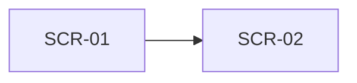

# Dựng màn hình prototype low-fi (Prototyping)

## 1. Mục đích
Prototyping là dựng nhanh một bản mô phỏng thô của giải pháp để stakeholder phản hồi sớm, trước khi team tốn công xây thật. Ở mức low-fi, mục tiêu là kiểm tra spec và AC có đủ để dựng màn hình không, không phải làm đẹp: mỗi màn hình cần nêu mục tiêu, thành phần, hành vi và các trạng thái mà người dùng sẽ gặp (rỗng, lỗi, tải chậm). Skill này biến spec và story thành mô tả màn hình truy vết được về AC, để chỗ thiếu của spec lộ ra thành câu hỏi mở thay vì bị phát hiện lúc code.

## 2. Đầu vào cần có
- Use case spec (đầu ra của `write-use-case-spec`): main flow, luồng A/E, tên trạng thái, mã BR (ví dụ BR-C1).
- User story kèm AC (đầu ra của `write-user-story-and-ac`) cho phạm vi cần dựng.
- Thiết bị và actor chính của màn hình (điện thoại, máy tính bảng, máy tính).
- Glossary hoặc thuật ngữ nhãn giao diện (tùy chọn).
- Yêu cầu HTML tĩnh (tùy chọn). Mặc định là **không** tạo; chỉ tạo khi người dùng nói rõ.

Thiếu đầu vào bắt buộc nào thì **hỏi lại người dùng trước khi làm**. Chưa có story và AC thì gợi ý chạy `write-user-story-and-ac` trước. Không tự bịa trường dữ liệu hay luồng không có trong spec.

## 3. Các bước
1. Chốt phạm vi: chọn story hoặc luồng cần dựng, thiết bị chính, và liệt kê các AC cần thể hiện lên màn hình.
2. Rút danh sách màn hình theo quy tắc cố định, đặt mã SCR-xx: (a) các bước main flow liên tiếp, cùng actor, không rẽ nhánh gộp thành một màn hình; (b) bước cần chọn từ danh sách dài hoặc nhập liệu riêng của một alternative thành màn hình phụ (popup, bottom sheet); (c) bước cuối hiển thị kết quả là một màn hình riêng; (d) exception không thêm màn hình, chỉ thêm trạng thái lỗi, trừ khi spec nói use case chuyển sang màn hình khác.
3. Vẽ luồng điều hướng giữa các màn hình bằng Mermaid.
4. Với mỗi màn hình: nêu mục tiêu, vẽ wireframe dạng text (một cột nếu là điện thoại), rồi lập bảng thành phần (tên, loại, dữ liệu, hành vi).
5. Mô tả đủ các trạng thái: bình thường, rỗng, lỗi, tải chậm; thêm mất mạng nếu chạy trên điện thoại. Mỗi trạng thái nói rõ khi nào xuất hiện, hiển thị gì, và AC nào quy định (xem `references/trang-thai-man-hinh.md`).
6. Dùng đúng tên trạng thái và thuật ngữ của spec. Thông báo lỗi phải cụ thể (nêu số, tên trường). Không tự đặt chỉ số hiệu năng: nếu cần ghi thời hạn thì dẫn "theo NFR-xx". Dữ liệu minh hoạ là giả và gắn `[GIẢ ĐỊNH]`.
7. Lập ma trận AC → màn hình. AC chưa có màn hình thì ghi lý do (ví dụ thuộc vai khác, dựng ở lượt sau).
8. Chỉ khi được yêu cầu: tạo HTML tĩnh theo `references/html-tinh-quy-tac.md`. Không yêu cầu thì ghi "HTML tĩnh: không tạo".
9. Thu những chỗ spec hoặc AC chưa đủ để vẽ vào Câu hỏi mở, ghi rõ ai trả lời.

## 4. Mẫu đầu ra
````markdown
## Prototype low-fi — <tên luồng> (<thiết bị>)
Nguồn: <UC-xx, US-xx, AC-xx, BR-Cx> · Độ chi tiết: low-fi · HTML tĩnh: <có / không tạo>
Quy ước: <ghi dữ liệu minh hoạ là [GIẢ ĐỊNH]>

### Danh sách màn hình
| Mã | Tên | Actor | Truy vết (UC bước / US / AC) |
|---|---|---|---|

### Luồng điều hướng


### SCR-xx · <tên màn hình>
**Mục tiêu:** <một câu>
```
<wireframe dạng text>
```
| Thành phần | Loại | Dữ liệu / hành vi | AC |
|---|---|---|---|

| Trạng thái | Khi nào | Hiển thị | AC |
|---|---|---|---|
| Bình thường / Rỗng / Lỗi / Tải chậm | ... | ... | ... |

### Ma trận AC → màn hình
| AC | Màn hình / trạng thái | Ghi chú |
|---|---|---|

### HTML tĩnh
<"Không tạo: người dùng chưa yêu cầu", hoặc đường dẫn file đã tạo>

### Câu hỏi mở
1. <câu hỏi> — cần <người trả lời>
````

## 5. Tự kiểm trước khi trả kết quả
- [ ] Mỗi màn hình có đủ trạng thái bình thường, rỗng, lỗi, tải chậm (hoặc ghi "không áp dụng" kèm lý do)?
- [ ] Mỗi AC trong phạm vi đều trỏ tới ít nhất một màn hình hoặc trạng thái, và AC chưa có màn hình có lý do?
- [ ] Thông báo lỗi và nhãn nút đều cụ thể, khớp tên trạng thái trong spec, không chung chung kiểu "Có lỗi xảy ra"?
- [ ] Mô tả vẫn ở mức low-fi (không màu, font, ảnh, hoạt ảnh) và không có thành phần ngoài spec hoặc story?
- [ ] Mọi dữ liệu minh hoạ là giả, có nhãn `[GIẢ ĐỊNH]`, không đến từ khách hàng thật?
- [ ] Chỉ tạo HTML tĩnh khi người dùng yêu cầu, và nếu tạo thì không có dữ liệu thật hay lời gọi ra ngoài?

## 6. BA phải verify
- Thành phần và trường dữ liệu AI tự thêm cho "đủ màn hình" mà spec không có: hỏi lại key user, rồi bổ sung vào spec nếu cần.
- Mức "vài bước" trên điện thoại: AI chỉ đếm bước theo mô tả, không thay cho thử với người dùng thật.
- Trạng thái rỗng, lỗi, tải chậm: AI hay bỏ sót hoặc viết chung chung; đối chiếu với từng exception trong spec.
- Tính khả thi kỹ thuật: bố cục có thể không khớp nền tảng cổng chưa chốt (web tùy biến hay Salesforce).
- Kiểm thử khả dụng cần thực hiện với người dùng thật (đại lý), không thay bằng prototype do AI mô tả.

## 7. An toàn dữ liệu
- Không đưa dữ liệu khách hàng thật vào. Dùng dữ liệu đã ẩn danh.
- Gắn nhãn `[GIẢ ĐỊNH]` cho mọi rule, số liệu, tên riêng không có nguồn trong đầu vào.
- Wireframe và HTML tĩnh chỉ chứa dữ liệu giả; không nhúng ảnh chụp màn hình hệ thống thật, không lời gọi mạng, không form gửi đi đâu.
- HTML tĩnh không chứa tài khoản, mật khẩu, khóa API, kể cả giá trị mẫu trông giống thật.

## 8. Câu hỏi mở
Luôn kết thúc đầu ra bằng mục này:

```
### Câu hỏi mở
1. <câu hỏi còn thiếu, ghi rõ cần ai trả lời>
```
