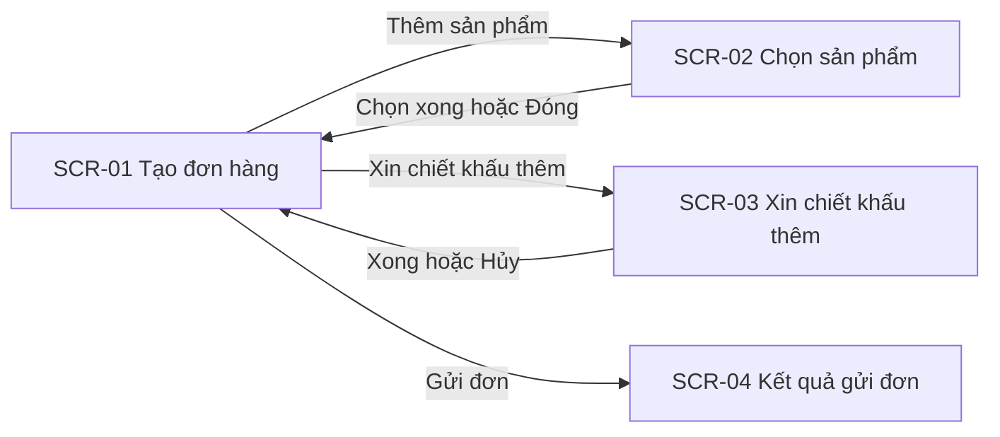

## Prototype low-fi — Tạo đơn hàng của đại lý (điện thoại)
Nguồn: UC-01 (main, A1, A2, E1–E5) · US-01, US-02, US-04, US-05 · AC-01 đến AC-10, AC-14 đến AC-21 · BR-C1, BR-C2, BR-C3, BR-C4, BR-C7 · Độ chi tiết: low-fi · HTML tĩnh: không tạo
Quy ước: mọi dữ liệu minh hoạ (sản phẩm SP-0001, 100.000 đ/cuộn, tồn 20 cuộn, mã đơn DH-2026-000101, địa chỉ) là `[GIẢ ĐỊNH]`. Nội dung thông báo lấy nguyên văn từ AC; nhãn chưa có trong AC cũng là `[GIẢ ĐỊNH]`. Không đặt chỉ số hiệu năng: thời hạn dẫn NFR-xx.

### Danh sách màn hình
| Mã | Tên | Actor | Truy vết (UC bước / US / AC) |
|---|---|---|---|
| SCR-01 | Tạo đơn hàng | Đại lý | UC-01 bước 1, 3–6 · US-01, US-04, US-05 · AC-01 đến 04, 14 đến 17, 19 đến 21 |
| SCR-02 | Chọn sản phẩm | Đại lý | UC-01 bước 2–3 · US-01 · AC-02, AC-18, AC-19 |
| SCR-03 | Xin chiết khấu thêm | Đại lý | UC-01 A1 (bước 5) · US-02 · AC-06 đến 10 |
| SCR-04 | Kết quả gửi đơn | Đại lý | UC-01 bước 7–8, E2 · US-01, US-02 · AC-01, AC-05, AC-07 đến 09 |

### Luồng điều hướng


### SCR-01 · Tạo đơn hàng
**Mục tiêu:** đại lý soạn đơn, chọn nơi giao, xin chiết khấu nếu cần, rồi gửi hoặc lưu nháp, trên một màn hình cuộn dọc.
```
+------------------------------+
| <  Tạo đơn hàng              |
+------------------------------+
| Đại lý: Nhân Phát            |
|                              |
| Sản phẩm (1)                 |
| +--------------------------+ |
| | Cáp điện SP-0001         | |
| | 100.000 đ / cuộn         | |
| | [-] [ 5 ] [+]  500.000 đ | |
| +--------------------------+ |
| [ + Thêm sản phẩm ]          |
|                              |
| Địa chỉ giao                 |
| [ Kho Nhân Phát, Đà Nẵng v ] |
| Ngày mong muốn               |
| [ __/__/____ ]               |
|                              |
| <Xin chiết khấu thêm>        |
| Tổng: 500.000 đ              |
+------------------------------+
| [ Lưu nháp ]  [ Gửi đơn ]    |
+------------------------------+
```
| Thành phần | Loại | Dữ liệu / hành vi | AC |
|---|---|---|---|
| Dòng sản phẩm | Thẻ | Tên, mã, giá niêm yết, bước tăng giảm số lượng, thành tiền; chạm vào số để nhập tay. Giá lấy từ ERP, không sửa được (BR-C2) | AC-01, 02, 03, 04 |
| Thêm sản phẩm | Nút phụ | Mở SCR-02 | AC-02 |
| Địa chỉ giao | Danh sách chọn | Chọn một địa chỉ giao của đại lý | AC-01 |
| Ngày mong muốn | Chọn ngày | Chọn ngày giao mong muốn | AC-01 |
| Xin chiết khấu thêm | Liên kết | Mở SCR-03; sau khi có chiết khấu đổi thành "Đã xin x,x%" | AC-06 đến 09 |
| Tổng | Văn bản | Tổng theo giá niêm yết, trừ chiết khấu đã xin | AC-01, 06 |
| Lưu nháp | Nút phụ | Lưu đơn ở trạng thái "Nháp" | AC-20, 21 |
| Gửi đơn | Nút chính, cố định cuối màn hình | Khoá khi chưa có dòng hợp lệ hoặc đang gửi | AC-01, 03, 15, 17 |

| Trạng thái | Khi nào | Hiển thị | AC |
|---|---|---|---|
| Bình thường | Đơn có ít nhất 1 dòng hợp lệ | Bố cục như hình; "Gửi đơn" bật | AC-01, AC-02 |
| Rỗng | Đơn chưa có dòng sản phẩm | "Đơn chưa có sản phẩm" kèm nút "+ Thêm sản phẩm"; "Gửi đơn" khoá; bấm "Lưu nháp" hiện "Thêm ít nhất 1 sản phẩm" | AC-21 |
| Lỗi số lượng | Nhập 21 khi tồn 20; hoặc nhập 0 hoặc để trống | Dòng viền lỗi, dưới dòng ghi "Chỉ còn 20 cuộn trong kho" hoặc "Số lượng tối thiểu là 1"; dòng lỗi không tính vào tổng; "Gửi đơn" khoá đến khi sửa | AC-03, AC-04 |
| Tải chậm | Kết nối chậm khi mở màn hình | Tiêu đề và hai nút hiện theo NFR-01; vùng sản phẩm hiện khung chờ "Đang tải danh mục"; không hiện giá hoặc tồn kho | AC-19 |
| Đang gửi | Sau khi bấm "Gửi đơn", chờ phản hồi | Nút đổi thành "Đang gửi", khoá để không gửi hai lần | AC-15, AC-17 |
| ERP không phản hồi khi ghi đơn (E3) | Hết thời gian chờ ERP sau khi gửi | Banner phía trên "Chưa gửi được đơn, vui lòng thử lại" trong thời hạn theo NFR-06; đơn chuyển "Nháp" nguyên nội dung; nút "Gửi lại" kiểm tra ERP trước khi gửi | AC-14, AC-15 |
| Mất mạng (E4) | Mất kết nối khi gửi | Hiện thông báo lỗi kết nối (nội dung chữ `[GIẢ ĐỊNH]`); đơn ở "Nháp" nguyên nội dung (NFR-07); có mạng lại thì mở đơn và "Gửi lại" | AC-16, AC-17 |
| Lưu nháp xong | Bấm "Lưu nháp" khi đơn hợp lệ | Thông báo ngắn "Đã lưu nháp" `[GIẢ ĐỊNH]`; đơn ở trạng thái "Nháp" | AC-20 |

### SCR-02 · Chọn sản phẩm
**Mục tiêu:** đại lý tìm và thêm sản phẩm, xem rõ giá niêm yết và tồn kho từ ERP.
```
+------------------------------+
| <  Chọn sản phẩm             |
+------------------------------+
| [ Tìm theo tên hoặc mã ____ ]|
|                              |
| Cáp điện SP-0001             |
| 100.000 đ / cuộn  ·  Còn 20  |
|                   [ Thêm ]   |
| ---------------------------- |
| (các sản phẩm khác)          |
+------------------------------+
```
| Thành phần | Loại | Dữ liệu / hành vi | AC |
|---|---|---|---|
| Ô tìm kiếm | Ô nhập | Lọc theo tên hoặc mã | AC-19 |
| Dòng sản phẩm | Danh sách | Tên, mã, giá niêm yết, tồn kho (đều từ ERP, chỉ đọc); "Thêm" thêm 1 đơn vị rồi quay lại SCR-01 | AC-02 |

| Trạng thái | Khi nào | Hiển thị | AC |
|---|---|---|---|
| Bình thường | Danh mục đã tải | Danh sách như hình | AC-02 |
| Rỗng | Tìm không có kết quả | "Không tìm thấy sản phẩm, thử tên hoặc mã khác" `[GIẢ ĐỊNH]` | Chưa có AC |
| Lỗi (E5) | ERP không phản hồi khi tải danh mục | "Chưa tải được danh mục, vui lòng thử lại" trong thời hạn theo NFR-06; không hiện giá, tồn kho; nút "Đóng" về SCR-01 (use case dừng, chưa có đơn nên không có "Nháp") | AC-18 |
| Tải chậm | Danh mục đang tải | Ô tìm kiếm hiện sẵn; danh sách là khung chờ, không hiện giá và tồn kho | AC-19 |

### SCR-03 · Xin chiết khấu thêm
**Mục tiêu:** đại lý nhập mức chiết khấu và lý do, thấy ngay ai sẽ duyệt và tổng dự kiến. Hiển thị dạng bottom sheet đè lên SCR-01.
```
+------------------------------+
| Xin chiết khấu thêm      [x] |
+------------------------------+
| Tổng niêm yết: 500.000 đ     |
| Chiết khấu (%)               |
| [ 7,0 ]                      |
| Lý do                        |
| [__________________________] |
| [__________________________] |
|                              |
| Người duyệt: TP Quản lý kênh |
| Tổng dự kiến: 465.000 đ      |
+------------------------------+
| [ Hủy ]            [ Xong ]  |
+------------------------------+
```
| Thành phần | Loại | Dữ liệu / hành vi | AC |
|---|---|---|---|
| Chiết khấu (%) | Ô nhập số | Một chữ số thập phân `[GIẢ ĐỊNH]` | AC-06 đến 09 |
| Lý do | Ô nhập nhiều dòng | Bắt buộc (BR-C4), từ 10 ký tự `[GIẢ ĐỊNH]` | AC-10 |
| Người duyệt | Văn bản tự đổi | Dưới 5,0%: "Không cần duyệt"; từ 5,0% đến 10,0%: "TP Quản lý kênh"; trên 10,0%: "Giám đốc Kinh doanh" (BR-C1) | AC-06 đến 09 |
| Tổng dự kiến | Văn bản | Tổng niêm yết trừ chiết khấu (BR-C3), tính lại khi đổi số | AC-06 đến 09 |
| Xong | Nút chính | Lưu chiết khấu vào đơn rồi quay lại SCR-01 | AC-06 đến 10 |

| Trạng thái | Khi nào | Hiển thị | AC |
|---|---|---|---|
| Bình thường | Đã nhập chiết khấu và lý do hợp lệ | Như hình; "Xong" bật | AC-06 đến 09 |
| Rỗng | Mới mở, chưa nhập | Hai ô để trống; người duyệt hiện "-"; "Xong" khoá | AC-10 |
| Lỗi | Lý do trống hoặc dưới 10 ký tự | Dưới ô lý do ghi "Nhập lý do xin chiết khấu"; chiết khấu không được lưu | AC-10 |
| Tải chậm | Không áp dụng: màn hình dùng dữ liệu đơn đang soạn, không gọi ERP | Không có | - |

### SCR-04 · Kết quả gửi đơn
**Mục tiêu:** cho đại lý biết đơn đã đi đến đâu và bước tiếp theo, không cần gọi điện hỏi.
```
+------------------------------+
|          Đã gửi đơn          |
+------------------------------+
| Mã đơn: DH-2026-000101       |
| Trạng thái: Đã xác nhận      |
| Tổng: 500.000 đ              |
|                              |
| Email xác nhận đã được gửi.  |
|                              |
| [ Theo dõi đơn ]             |
| [ Tạo đơn mới ]              |
+------------------------------+
```
| Thành phần | Loại | Dữ liệu / hành vi | AC |
|---|---|---|---|
| Mã đơn, trạng thái, tổng | Văn bản | Mã đơn dạng "DH-2026-000101" `[GIẢ ĐỊNH]`; tên trạng thái đúng như spec | AC-01 |
| Theo dõi đơn | Nút phụ | Sang màn hình Theo dõi đơn (F4), ngoài phạm vi lần này | - |
| Tạo đơn mới | Nút chính | Về SCR-01 ở trạng thái Rỗng | AC-21 |

| Trạng thái | Khi nào | Hiển thị | AC |
|---|---|---|---|
| Đã xác nhận | Đơn ghi vào ERP | Như hình; mã đơn hiện ngay khi đơn được ghi vào ERP | AC-01 |
| Chờ duyệt chiết khấu | Chiết khấu từ 5,0% | Trạng thái "Chờ duyệt chiết khấu", nêu người duyệt (TP Quản lý kênh hoặc Giám đốc Kinh doanh) và tổng dự kiến; không nói đơn đã xác nhận | AC-07, 08, 09 |
| Chờ kế toán xử lý | Quá hạn công nợ | "Đơn đang chờ xử lý" (BR-C7); không hiển thị số tiền công nợ `[GIẢ ĐỊNH]` | AC-05 |
| Rỗng, Lỗi, Tải chậm | Không áp dụng: màn hình chỉ hiện sau khi đã có kết quả; lỗi gửi xử lý ở SCR-01 | Không có | - |

### Ma trận AC → màn hình
| AC | Màn hình / trạng thái | Ghi chú |
|---|---|---|
| AC-01 | SCR-01 Bình thường; SCR-04 Đã xác nhận | |
| AC-02 | SCR-01 Bình thường; SCR-02 Bình thường | |
| AC-03, AC-04 | SCR-01 Lỗi số lượng | |
| AC-05 | SCR-04 Chờ kế toán xử lý | |
| AC-06 đến AC-09 | SCR-03 Bình thường; SCR-01 (Tổng); SCR-04 Chờ duyệt chiết khấu (từ AC-07) | AC-06 áp ngay nên đơn đi tiếp như bình thường |
| AC-10 | SCR-03 Lỗi | AC viết "khi Gửi đơn", prototype chặn ở nút "Xong"; xem Câu hỏi mở 5 |
| AC-14, AC-15 | SCR-01 ERP không phản hồi khi ghi đơn, Đang gửi | |
| AC-16, AC-17 | SCR-01 Mất mạng, Đang gửi | |
| AC-18 | SCR-02 Lỗi | E5: use case dừng |
| AC-19 | SCR-01 và SCR-02 Tải chậm | |
| AC-20, AC-21 | SCR-01 Lưu nháp xong, Rỗng | |
| AC-11 đến AC-13 | Chưa có | Thuộc màn hình duyệt của TP Quản lý kênh (US-03, UC-02 chưa viết), dựng ở lượt sau |

### HTML tĩnh
Không tạo: người dùng chưa yêu cầu.

### Câu hỏi mở
1. "Vài bước" (R5) là tối đa bao nhiêu lần chạm? Luồng hiện tại cần khoảng 8 lần chạm cho đơn 1 sản phẩm × 5 cuộn (chưa tính gõ số lượng) — cần Anh Nhân và Chị Hạnh trả lời, rồi thử với đại lý thật.
2. Đơn "Chờ duyệt chiết khấu" và "Chờ kế toán xử lý" đã có mã đơn chưa, và mã đó do cổng hay ERP cấp? SCR-04 chưa biết nên hiện mã hay không — cần Chị Loan, Chị Hạnh.
3. Sản phẩm tồn kho bằng 0 có hiện trong SCR-02 và cho thêm không? Spec chỉ có E1 (số lượng lớn hơn tồn) — cần Chị Hạnh.
4. Theo E5 use case dừng, SCR-02 trạng thái Lỗi chỉ có nút "Đóng" và đại lý phải mở lại danh mục từ đầu. Có cần nút "Thử lại" tại chỗ không (khi đó E5 cần sửa) — cần BA và Chị Hạnh.
5. AC-10 kiểm lý do khi bấm "Gửi đơn", prototype kiểm ngay ở "Xong" trong SCR-03. Chọn cách nào, hay kiểm cả hai nơi — cần Chị Hạnh và BA.
6. Nền tảng cổng đại lý (web tùy biến hay Salesforce) chưa chốt, nên bố cục bottom sheet và thanh nút cố định có thể phải đổi — cần Anh Quang, Anh Kiên.
