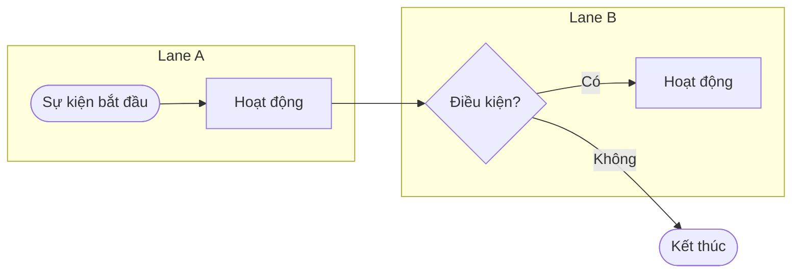

# Mô hình hóa quy trình nghiệp vụ (Process Modelling)

## 1. Mục đích
Process Modelling biểu diễn bằng hình các hoạt động, điểm quyết định, người thực hiện và điểm bàn giao của một quy trình, từ sự kiện bắt đầu đến kết quả cuối. BA dùng nó để hiểu hiện trạng (As-is), chốt phạm vi và thiết kế quy trình mong muốn (To-be) trước khi đi vào use case. Skill này đọc mô tả bằng chữ, dựng flowchart Mermaid trong đó mỗi lane (subgraph) là một actor hoặc hệ thống, theo tinh thần BPMN.

## 2. Đầu vào cần có
- Mô tả quy trình bằng chữ, ghi rõ là As-is hay To-be. Người dùng chỉ nói "vẽ sơ đồ" thì hỏi lại loại sơ đồ (quy trình, tuần tự hay trạng thái).
- Danh sách actor, bộ phận hoặc hệ thống tham gia (mỗi cái sẽ thành một lane).
- Sự kiện bắt đầu và kết quả kết thúc mong muốn.
- Tùy chọn: rule và ngưỡng quyết định, pain point hiện tại, mã tham chiếu (UC, R, BR).

Thiếu đầu vào bắt buộc nào thì **hỏi lại người dùng trước khi làm**. Không tự bịa để lấp chỗ trống.

## 3. Các bước
1. Xác định As-is hay To-be, điểm bắt đầu, điểm kết thúc. Một sơ đồ nên có tối đa khoảng 20 nút; dài hơn thì vẽ quy trình chính với node quy trình con `SUB1[["..."]]` và vẽ mỗi quy trình con thành sơ đồ riêng (mã `P`, `GW`, `EN` đánh liên tục, không trùng giữa các sơ đồ). Giữ một sơ đồ lớn thì phải ghi lý do.
2. Liệt kê actor và hệ thống, mỗi bên một lane. Hệ thống ngoài (ERP, Email) là lane riêng nếu có hoạt động của chính nó.
3. Tách mô tả thành hoạt động dạng "động từ + đối tượng", gán đúng một lane, đánh mã `P1, P2...` theo thứ tự thời gian.
4. Tìm điểm quyết định, đánh mã `GW1, GW2...`; mỗi nhánh ra có nhãn điều kiện, các nhánh phủ kín (không hở khoảng giữa các ngưỡng).
5. Thêm nhánh lỗi và nhánh biên: từ chối, quá hạn, thiếu hàng, hệ thống lỗi. Mọi đường đi phải tới một nút kết thúc (`EN1, EN2...`).
6. Vẽ Mermaid theo `references/bpmn-symbols.md`. Chỗ mô tả không nói rõ thì vẽ kèm nhãn `[GIẢ ĐỊNH]`, không tự quyết im lặng.
7. Lập bảng bước (đủ mọi nút trong sơ đồ, kể cả `ST` và `EN`), nhánh lỗi, rồi điểm đau (As-is) hoặc khác biệt so với As-is (To-be).
8. Soát cú pháp, kết thúc bằng "Câu hỏi mở".

## 4. Mẫu đầu ra
````markdown
## Quy trình: <tên> (<As-is | To-be>)
**Phạm vi**: Bắt đầu: <sự kiện> · Kết thúc: <kết quả> · Lane: <danh sách>

### Sơ đồ (thêm một khối cho mỗi quy trình con nếu có)


### Bảng bước
| Mã | Lane | Hoạt động / Quyết định | Điều kiện nhánh | Đầu ra | Nguồn |
|---|---|---|---|---|---|

### Nhánh lỗi và nhánh biên
- <nhánh đã vẽ hoặc chưa vẽ, lý do>

### Điểm đau / cải tiến
- As-is: pain point · To-be: khác biệt so với As-is

### Câu hỏi mở
1. <câu hỏi, ghi rõ cần ai trả lời>
````

Mermaid không ép node nằm đúng lane. Hãy khai báo node bên trong đúng `subgraph`, còn mũi tên giữa các lane khai báo bên ngoài các khối `subgraph`.

## 5. Tự kiểm trước khi trả kết quả
- [ ] Mỗi hoạt động nằm đúng một lane và bắt đầu bằng động từ?
- [ ] Mỗi gateway có đủ nhánh, nhánh nào cũng có nhãn điều kiện, các ngưỡng không hở không chồng?
- [ ] Mọi đường đi đều tới một nút kết thúc, không có nút "treo"?
- [ ] Có nhánh từ chối, quá hạn hoặc lỗi hệ thống (vẽ hoặc ghi rõ vì sao chưa vẽ)?
- [ ] Mọi mã `ST`, `P`, `GW`, `EN` (và `SUB` nếu có) trong sơ đồ có đúng một dòng trong bảng bước, và mỗi sơ đồ không quá khoảng 20 nút?
- [ ] Nhãn node đặt trong dấu ngoặc kép, không chứa `;` hay `#`, id node không trùng?

## 6. BA phải verify
- Ai thực sự làm bước nào: AI hay gán hoạt động cho lane "hợp lý" thay vì lane thực tế.
- Bước ngầm mà người kể bỏ qua (kiểm tra, nhập lại, nhắn Zalo) nhất là ở As-is; AI có xu hướng vẽ As-is đẹp hơn thực tế.
- Thứ tự các bước kiểm tra (ví dụ duyệt trước hay kiểm tra công nợ trước) và các ngưỡng quyết định.
- Nhánh `[GIẢ ĐỊNH]` phải được stakeholder xác nhận trước khi dùng làm đầu vào cho use case.

## 7. An toàn dữ liệu
- Không đưa dữ liệu khách hàng thật vào. Dùng dữ liệu đã ẩn danh.
- Gắn nhãn `[GIẢ ĐỊNH]` cho mọi rule, số liệu, tên riêng không có nguồn trong đầu vào.
- Tên người thật trong lời kể: thay bằng vai trò (ví dụ "TP Quản lý kênh") trong sơ đồ và bảng.

## 8. Câu hỏi mở
Luôn kết thúc đầu ra bằng mục này:

```
### Câu hỏi mở
1. <câu hỏi còn thiếu, ghi rõ cần ai trả lời>
```
