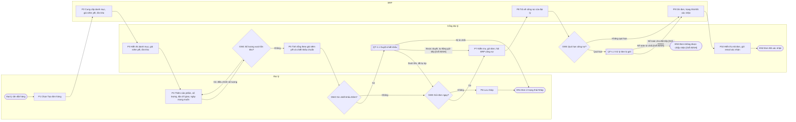
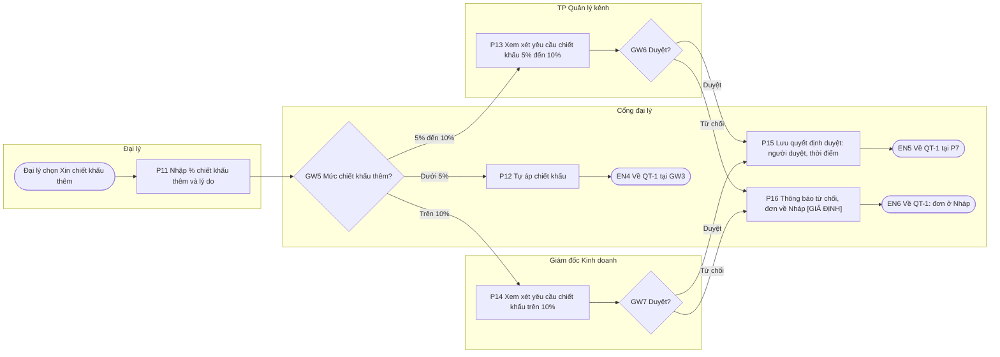
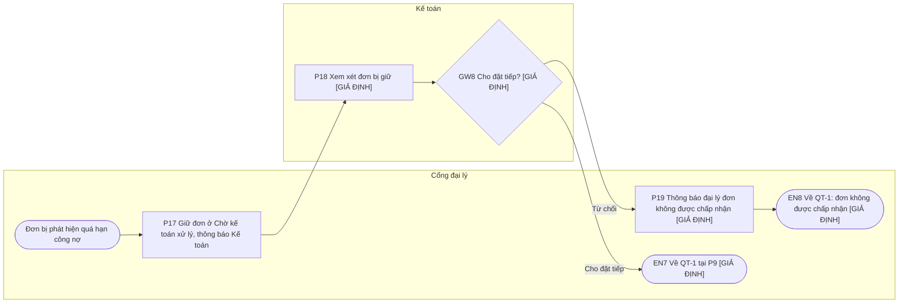

## Quy trình: Đặt hàng của đại lý trên cổng (To-be)
**Phạm vi**: Bắt đầu: Đại lý cần đặt hàng · Kết thúc: đơn "Đã xác nhận" trong ERP, hoặc đơn ở "Nháp", hoặc đơn không được chấp nhận · Lane: Đại lý, Cổng đại lý, TP Quản lý kênh, Giám đốc Kinh doanh, Kế toán, ERP

Để mỗi hình không quá khoảng 20 nút, quy trình được chia thành quy trình chính QT-1 (20 nút) và hai quy trình con QT-1.1, QT-1.2.

### Sơ đồ QT-1 Đặt hàng (quy trình chính)

### Sơ đồ QT-1.1 Duyệt chiết khấu (quy trình con, từ GW2 nhánh "Có")

### Sơ đồ QT-1.2 Xử lý đơn bị giữ (quy trình con, từ GW4 nhánh "Quá hạn")

### Bảng bước
Cột "Nguồn" dẫn UC-01 theo mã bước và luồng của spec (7a kiểm tra công nợ, 7b ghi đơn).

**QT-1 Đặt hàng**
| Mã | Lane | Hoạt động / Quyết định | Điều kiện nhánh | Đầu ra | Nguồn |
|---|---|---|---|---|---|
| ST | Đại lý | Sự kiện bắt đầu: Đại lý cần đặt hàng | | Yêu cầu đặt hàng | UC-01 trigger |
| P1 | Đại lý | Chọn "Tạo đơn hàng" | | Yêu cầu tạo đơn | UC-01 bước 1 |
| P2 | ERP | Cung cấp danh mục, giá niêm yết, tồn kho | | Dữ liệu danh mục | UC-01 bước 2; BR-C2 |
| P3 | Cổng đại lý | Hiển thị danh mục, giá niêm yết, tồn kho | | Màn hình danh mục | UC-01 bước 2 |
| P4 | Đại lý | Thêm sản phẩm, số lượng; chọn địa chỉ giao, ngày mong muốn | | Đơn đang soạn | UC-01 bước 3-4 |
| GW1 | Cổng đại lý | Số lượng vượt tồn kho? | Có → P4 · Không → P5 | | UC-01 E1 (bước 3) |
| P5 | Cổng đại lý | Tính tổng theo giá niêm yết và chiết khấu chuẩn | | Tổng tiền tạm tính | UC-01 bước 5; BR-C3 |
| GW2 | Đại lý | Xin chiết khấu thêm? | Có → SUB1 · Không → GW3 | | UC-01 A1 (bước 5) |
| SUB1 | Cổng đại lý | Quy trình con QT-1.1 Duyệt chiết khấu | Dưới 5% → GW3 · Được duyệt → P7 · Bị từ chối → EN1 | | UC-01 A1; F5 |
| GW3 | Đại lý | Gửi đơn ngay? | Có → P7 · Không → P6 | | UC-01 A2 (bước 6) |
| P6 | Đại lý | Lưu nháp | | Đơn "Nháp" | UC-01 A2 |
| P7 | Cổng đại lý | Kiểm tra đơn, gửi đơn, hỏi ERP công nợ | | Yêu cầu kiểm tra công nợ | UC-01 bước 6, 7a |
| P8 | ERP | Trả về tình trạng công nợ của đại lý | | Kết quả công nợ | UC-01 bước 7a |
| GW4 | Cổng đại lý | Quá hạn công nợ? | Quá hạn → SUB2 · Không quá hạn → P9 | | UC-01 E2 (bước 7); R11 |
| SUB2 | Cổng đại lý | Quy trình con QT-1.2 Xử lý đơn bị giữ | Cho đặt tiếp → P9 · Từ chối → EN3 | | UC-01 E2; BR-C7 |
| P9 | ERP | Ghi đơn, trạng thái "Đã xác nhận" | | Đơn trong ERP | UC-01 bước 7b; R2; BR-C6 |
| P10 | Cổng đại lý | Hiển thị mã đơn, gửi email xác nhận | | Mã đơn, email | UC-01 bước 8 |
| EN1 | Đại lý | Kết thúc: đơn ở trạng thái "Nháp" | | Đơn "Nháp" | UC-01 A2 |
| EN2 | Cổng đại lý | Kết thúc: đơn "Đã xác nhận" | | Đơn "Đã xác nhận" | UC-01 postcondition |
| EN3 | Cổng đại lý | Kết thúc: đơn không được chấp nhận | | Đơn bị từ chối | `[GIẢ ĐỊNH]` |

**QT-1.1 Duyệt chiết khấu**
| Mã | Lane | Hoạt động / Quyết định | Điều kiện nhánh | Đầu ra | Nguồn |
|---|---|---|---|---|---|
| ST2 | Đại lý | Sự kiện bắt đầu: chọn "Xin chiết khấu thêm" | | Yêu cầu chiết khấu | UC-01 A1 |
| P11 | Đại lý | Nhập % chiết khấu thêm và lý do | | Yêu cầu chiết khấu | BR-C4 |
| GW5 | Cổng đại lý | Mức chiết khấu thêm? | Dưới 5% → P12 · 5% đến 10% → P13 · Trên 10% → P14 | | BR-C1 `[GIẢ ĐỊNH]` ngưỡng |
| P12 | Cổng đại lý | Tự áp chiết khấu | | Đơn đã có chiết khấu | BR-C1 |
| P13 | TP Quản lý kênh | Xem xét yêu cầu chiết khấu (đơn ở "Chờ duyệt chiết khấu") | | Quyết định | BR-C1; F5 |
| GW6 | TP Quản lý kênh | Duyệt? | Duyệt → P15 · Từ chối → P16 | | F5 |
| P14 | Giám đốc Kinh doanh | Xem xét yêu cầu chiết khấu (đơn ở "Chờ duyệt chiết khấu") | | Quyết định | BR-C1; F5 |
| GW7 | Giám đốc Kinh doanh | Duyệt? | Duyệt → P15 · Từ chối → P16 | | F5 |
| P15 | Cổng đại lý | Lưu quyết định (người duyệt, thời điểm) | | Bản ghi duyệt | BR-C5; R7 |
| P16 | Cổng đại lý | Thông báo từ chối, đơn về "Nháp" | | Đơn "Nháp" | `[GIẢ ĐỊNH]` |
| EN4 | Cổng đại lý | Về QT-1 tại GW3 (tổng đã tính lại) | | | UC-01 A1 (a) |
| EN5 | Cổng đại lý | Về QT-1 tại P7, tự động gửi tiếp | | | UC-01 A1 (b) `[GIẢ ĐỊNH]` |
| EN6 | Cổng đại lý | Về QT-1: đơn ở "Nháp" (EN1) | | | `[GIẢ ĐỊNH]` |

**QT-1.2 Xử lý đơn bị giữ**
| Mã | Lane | Hoạt động / Quyết định | Điều kiện nhánh | Đầu ra | Nguồn |
|---|---|---|---|---|---|
| ST3 | Cổng đại lý | Sự kiện bắt đầu: đơn bị phát hiện quá hạn công nợ | | | UC-01 E2 |
| P17 | Cổng đại lý | Giữ đơn ở "Chờ kế toán xử lý", thông báo Kế toán | | Đơn bị giữ | UC-01 E2; BR-C7 |
| P18 | Kế toán | Xem xét đơn bị giữ | | Quyết định | `[GIẢ ĐỊNH]` |
| GW8 | Kế toán | Cho đặt tiếp? | Cho → EN7 · Từ chối → P19 | | `[GIẢ ĐỊNH]` |
| P19 | Cổng đại lý | Thông báo đại lý đơn không được chấp nhận | | Thông báo | `[GIẢ ĐỊNH]` |
| EN7 | Cổng đại lý | Về QT-1 tại P9 | | | `[GIẢ ĐỊNH]` |
| EN8 | Cổng đại lý | Về QT-1: đơn không được chấp nhận (EN3) | | | `[GIẢ ĐỊNH]` |

### Nhánh lỗi và nhánh biên
- Đã vẽ: vượt tồn kho (GW1), chiết khấu bị từ chối (P16), quá hạn công nợ (QT-1.2), lưu nháp (P6).
- UC-01 theo case chỉ có E1, E2. Ba exception E3 (ERP không phản hồi khi ghi đơn, bước 7), E4 (mất kết nối khi đại lý gửi đơn, bước 6), E5 (ERP không phản hồi khi tải danh mục, bước 2) do BA đề xuất ở `write-use-case-spec` `[GIẢ ĐỊNH]`. Chưa vẽ vào quy trình này; nếu được xác nhận thì thêm nhánh "về Nháp" sau P7 và P9 (E3), sau GW3 (E4) và nhánh dừng sau P2 (E5).
- Chưa vẽ: người duyệt không xử lý trong thời hạn nào đó.

### Điểm đau / cải tiến
- As-is (theo case): đặt hàng qua email, Zalo, Excel; sales admin nhập tay vào ERP (~60 đơn/ngày `[GIẢ ĐỊNH]`, sai mã/số lượng); duyệt chiết khấu qua Zalo, không lưu vết; đại lý không thấy trạng thái đơn.
- To-be khác As-is: giá và tồn kho lấy thẳng từ ERP (P2, BR-C2); đơn ghi vào ERP không cần gõ lại (P9, R2); mỗi quyết định duyệt lưu người và thời điểm (P15, BR-C5, R7); đơn có trạng thái để theo dõi (F4).

### Câu hỏi mở
1. Chiết khấu bị từ chối thì đơn về "Nháp" hay đại lý được xin lại ngay trên đơn đó, có giới hạn số lần không? (Chị Hạnh, Anh Quang)
2. Sau khi chiết khấu được duyệt, đơn tự động đi tiếp kiểm tra công nợ hay đại lý phải bấm gửi lại? (Chị Hạnh)
3. Kế toán có những lựa chọn nào với đơn bị giữ vì quá hạn công nợ, và có thời hạn xử lý không? (Chị Loan)
4. Chiết khấu dưới 5% đại lý tự áp có đi qua nhánh "xin chiết khấu thêm" (A1) hay chỉ nhập trực tiếp? (Chị Hạnh)
5. Người duyệt vắng hoặc không xử lý thì ai thay, sau bao lâu thì nhắc hoặc chuyển cấp trên? (Anh Quang)
6. Có đưa E3, E4, E5 vào phạm vi Phase 1 và vẽ vào quy trình không, và ERP xử lý hết thời gian chờ thế nào? (Chị Loan, Anh Kiên)
